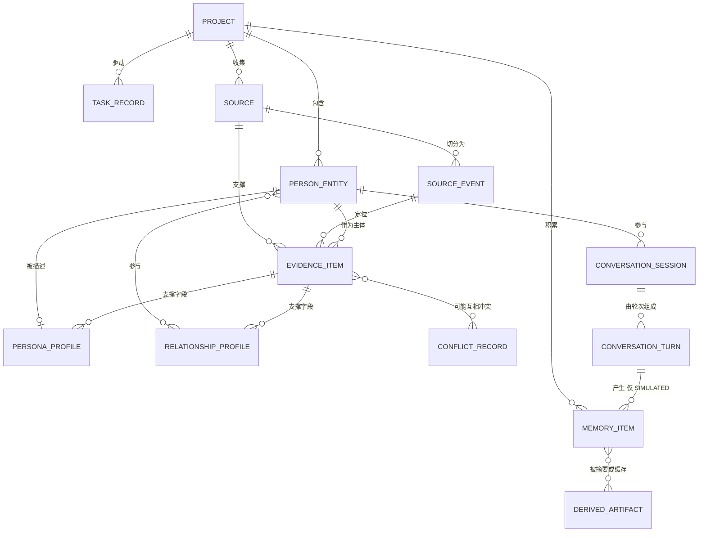
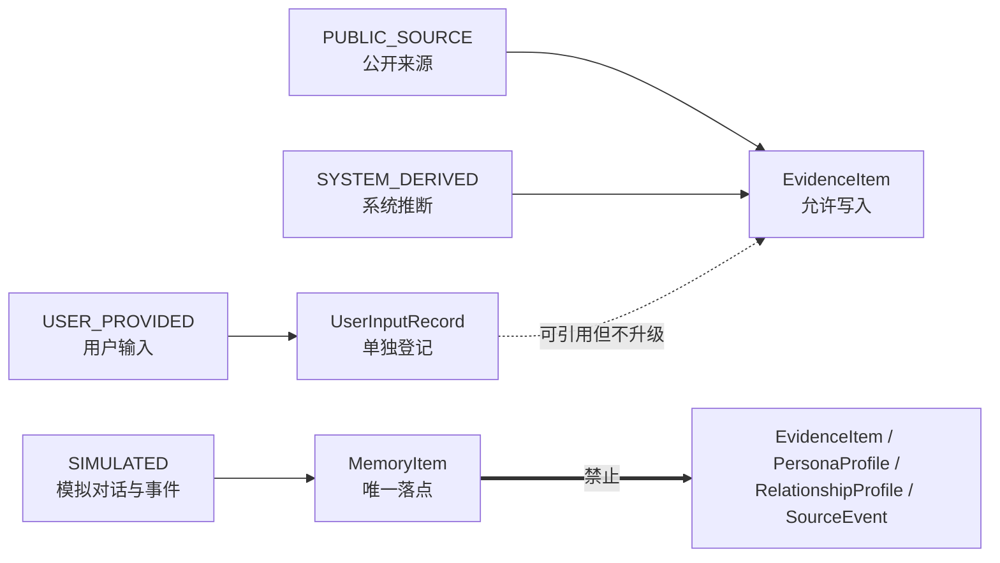

# DATA_MODEL —— 核心数据模型设计

- **版本**：v0.2.1（P1.2-A 同步）
- **状态**：待人工验收
- **适用**：Python 3.12+ / 本地 CLI / 模块化单体 / SQLite
- **相关文档**：`README.md`、`PROJECT_SPEC.md`、`ARCHITECTURE.md`、`INTERFACES.md`、`ERROR_HANDLING.md`、`ROADMAP.md`、`DECISIONS.md`
- **相关文档**：`README.md`、`PROJECT_SPEC.md`、`ARCHITECTURE.md`、`ROADMAP.md`、`DECISIONS.md`

---

## 0. 本次更新说明

本文档**重写** `DATA_MODEL.md`（v0.1 → v0.2）。变更性质：

| 变更 | 说明 |
| --- | --- |
| 新增实体 | `Project`、`SourceEvent`、`TaskRecord`、`ConflictRecord`、`DerivedArtifact` |
| 新增维度 | `EntityType`（真人与虚构角色）、改编版本与平行时间线隔离 |
| 重命名 | `Run` → `Project`；`Person` → `PersonEntity`；`Persona` → `PersonaProfile`；证据级别 `PROFILE` → `PROFILE_BACKGROUND`；`origin` → `namespace` |
| 强化 | 来源转载/二次引用归并、模拟记忆删除后的摘要与缓存残留治理 |
| 保留 | 稳定性闸门、四项硬约束 INV-1~INV-4 的精神、冲突不裁决原则 |

> ⚠️ 本文**不修改** `README.md`、`PROJECT_SPEC.md`、`ARCHITECTURE.md`、`ROADMAP.md`、`DECISIONS.md`。
> 需要的联动改动列在 §9，**等你确认后再动手**。

---

## 1. 读前必看：三个互相独立的维度

这是整个模型最容易搞混的地方。三条轴互不隶属，**任何一条都可能组合**：

| 维度 | 名字 | 取值 | 回答的问题 |
| --- | --- | --- | --- |
| ① 对象类型 | `EntityType` | `REAL_PERSON` / `FICTIONAL_CHARACTER` | 「被模拟的是**真人还是虚构角色**？」 |
| ② 来源命名空间 | `ProvenanceNamespace` | `PUBLIC_SOURCE` / `SYSTEM_DERIVED` / `USER_PROVIDED` / `SIMULATED` | 「这条数据来自**哪个世界**？」 |
| ③ 证据级别 | `EvidenceTier` | `VERBATIM` / `PROFILE_BACKGROUND` / `THIRD_PARTY` / `INFERENCE` | 「这是**哪一类说法**？」 |

**举例**：

- 一位公开演讲者在访谈里说的话 → ①`REAL_PERSON` ②`PUBLIC_SOURCE` ③`VERBATIM`
- 游戏角色在主线剧情里的台词 → ①`FICTIONAL_CHARACTER` ②`PUBLIC_SOURCE` ③`VERBATIM`
- 粉丝 wiki 对该角色的解读 → ①`FICTIONAL_CHARACTER` ②`PUBLIC_SOURCE` ③`THIRD_PARTY`（且 `canon_level = NON_CANON`）
- 系统据此推断"他很谨慎" → ②`SYSTEM_DERIVED` ③`INFERENCE`
- 模拟对话里他承认了自己的错误 → ②`SIMULATED`（**只能进 `MemoryItem`，永远进不了 `EvidenceItem`**）

> **`EvidenceTier` 高 ≠ 更真实。** 它只决定「冲突时先看谁」，不负责判定对错。

---

## 2. 全局规范

### 2.1 ID 规则

统一采用 `uuid4` 字符串 + 业务前缀：**永远不会因为排序或业务含义而变**，因此可以安全地跨模块传递（对应架构的黑板模式）。

| 实体 | 前缀 | 示例 |
| --- | --- | --- |
| Project | `prj_` | `prj_1a2b…` |
| PersonEntity | `pe_` | `pe_9f21…` |
| Source | `src_` | `src_4d0e…` |
| SourceEvent | `sev_` | `sev_7c33…` |
| EvidenceItem | `evd_` | `evd_88af…` |
| ConflictRecord | `cfl_` | `cfl_02be…` |
| PersonaProfile | `pnf_` | `pnf_de10…` |
| RelationshipProfile | `rlp_` | `rlp_55c7…` |
| ConversationSession | `css_` | `css_b3a9…` |
| ConversationTurn | `ctn_` | `ctn_1f04…` |
| MemoryItem | `mem_` | `mem_6e72…` |
| TaskRecord | `tsk_` | `tsk_0aa5…` |
| DerivedArtifact | `dar_` | `dar_c912…` |

### 2.2 通用字段（每条记录都有）

| 字段 | 类型 | 必填 | 含义 |
| --- | --- | --- | --- |
| `id` | `str` | ✅ | 主键，见 §2.1 |
| `project_id` | `str` | ✅ | 所属项目，外键 → `Project.id` |
| `namespace` | `ProvenanceNamespace` | ✅ | 这条数据来自哪个世界 |
| `created_by` | `str` | ✅ | 产生它的模块或角色，如 `research` / `dialogue` / `user` |
| `created_at` | `datetime` | ✅ | 创建时间（UTC） |
| `updated_at` | `datetime` | ✅ | 更新时间 |
| `deleted_at` | `datetime \| None` | ⭕ | **软删除**。所有删除一律软删除 + 审计，不物理删除 |
| `schema_version` | `int` | ✅ | 结构版本，便于旧数据迁移 |

### 2.3 模糊时间

现实里大量时间是不精确的（"九十年代初""第二季之后"）。统一用结构表达，**禁止塞成字符串丢进单个日期字段**：

```json
{ "raw": "九十年代初", "start": "1990-01-01", "end": "1993-12-31", "precision": "RANGE" }
```

`precision`：`EXACT` / `DAY` / `MONTH` / `YEAR` / `RANGE` / `UNKNOWN` / `WORK_INTERNAL`（作品内部时间，如"第 4 集之后"）。

---

## 3. 实体总览与关系图

共 **13 个实体**：11 个业务核心 + 2 个支撑实体（`ConflictRecord`、`DerivedArtifact`）。

### 3.1 Mermaid 实体关系图



### 3.2 命名空间流向图（隔离红线）



> 那根粗箭头是**系统里不存在的路径**。它不是"规定不能走"，而是**代码里根本没有这条路**——`Dialogue` 拿不到任何写 `EvidenceItem` 的方法。

---

## 4. 实体逐个详解

> 图例：✅ 必填 ｜ ⭕ 可选

---

### 4.1 Project —— 一次人物与关系模拟项目

**用途**：一次完整任务的容器。以前叫 `Run`，改名是为了更贴近"一个项目里可以反复研究、反复对话"的实际用法。

**责任边界**：只负责"装东西和记账"，**不保存任何具体的研究内容或对话内容**。所有内容在子表里，用 `project_id` 挂上来。

| 字段 | 类型 | 必填 | 含义 |
| --- | --- | --- | --- |
| `name` | `str` | ✅ | 项目名 |
| `description` | `str \| None` | ⭕ | 说明 |
| `status` | `ProjectStatus` | ✅ | `DRAFT` / `RESEARCHING` / `READY` / `DIALOGUING` / `PAUSED` / `COMPLETED` / `FAILED` |
| `entity_ids` | `list[str]` | ✅ | 本项目的 `PersonEntity` 列表（外键） |
| `entity_type_mix` | `list[EntityType]` | ✅ | 本项目涉及的对象类型（可同时含真人与虚构角色） |
| `default_topic` | `str \| None` | ⭕ | 默认对话话题 |
| `budget_limit` | `BudgetSpec \| None` | ⭕ | 预算上限 |
| `budget_used` | `BudgetUsage` | ✅ | 已消耗量 |
| `active_task_ids` | `list[str]` | ✅ | 正在跑的 `TaskRecord` |
| `settings` | `ProjectSettings` | ✅ | 开关集合：是否允许虚构角色、发言人策略、上下文窗口策略等 |

**关联方式**：被所有实体以 `project_id` 外键引用（一对多）。

**数据来源**：`CLI` 创建 → `Orchestrator` 维护。

**生命周期**：`DRAFT` → … → `COMPLETED` / `FAILED`。项目可长期存在、被重新打开。

**校验规则**：

- `PV-1`：`entity_ids` 至少包含 **2 个**元素（产品规则要求两人以上）。
- `PV-2`：`status` 进入 `COMPLETED` 时，`budget_used` 各项必须已结算。
- `PV-3`：删除项目必须级联软删除其所有子记录，并写审计日志。

**通用示例**：

```json
{
  "id": "prj_1a2b",
  "name": "示例项目：双人对谈",
  "status": "RESEARCHING",
  "entity_ids": ["pe_9f21", "pe_3c7b"],
  "entity_type_mix": ["REAL_PERSON", "FICTIONAL_CHARACTER"],
  "budget_limit": { "max_calls": 200, "max_tokens": 300000 }
}
```

---

### 4.2 PersonEntity —— 被模拟的对象（真人 / 虚构角色）

**用途**：统一描述"谁要被模拟"。**真人和虚构角色共用一张表**，差异靠 `entity_type` + 两个可选扩展块表达，**不复制两套系统**。

**责任边界**：只回答"这是谁"。**不保存性格、经历、来源**——那些分别在 `PersonaProfile` 和 `EvidenceItem` 里。

| 字段 | 类型 | 必填 | 含义 |
| --- | --- | --- | --- |
| `entity_type` | `EntityType` | ✅ | `REAL_PERSON` / `FICTIONAL_CHARACTER` |
| `display_name` | `str` | ✅ | 显示名 |
| `aliases` | `list[str]` | ⭕ | 别名、译名、称号 |
| `disambiguation_note` | `str \| None` | ⭕ | 重名消歧说明 |
| `real_person_meta` | `RealPersonMeta \| None` | 条件必填 | `REAL_PERSON` 时必填；虚构角色必须为 `null` |
| `fictional_character_meta` | `FictionalCharacterMeta \| None` | 条件必填 | `FICTIONAL_CHARACTER` 时必填；真人必须为 `null` |
| `variant_group_id` | `str \| None` | ⭕ | 同一角色的不同改编/平行时间线**共用一个组 ID** |
| `merge_policy` | `MergePolicy` | ✅ | `NEVER_AUTO_MERGE`（默认）/ `MERGE_ALLOWED` |
| `status` | `PersonStatus` | ✅ | `OK` / `AMBIGUOUS` / `INSUFFICIENT_EVIDENCE` |
| `primary_universe_ref` | `str \| None` | ⭕ | 所属世界观/现实语境标识 |

**`RealPersonMeta`**：

| 字段 | 类型 | 含义 |
| --- | --- | --- |
| `public_identity_tags` | `list[str]` | 公开身份标签，如"某领域评论者" |
| `activity_periods` | `list[FuzzyDateRange]` | 公开活动时期 |
| `known_work_refs` | `list[str]` | 代表作品/任职机构等（仅登记，不展开） |
| `privacy_handling` | `PrivacyPolicy` | `PUBLIC_FIGURE_STANDARD` / `RESTRICTED` |

**`FictionalCharacterMeta`**：

| 字段 | 类型 | 含义 |
| --- | --- | --- |
| `works` | `list[WorkRef]` | 所属作品（标题、媒介：小说/漫画/动画/游戏/真人剧） |
| `series_universe_id` | `str \| None` | 世界观/系列 ID |
| `adaptation_version` | `str` | 改编版本，如"2020 年动画改编版" |
| `adaptation_lineage` | `list[str]` | 改编血缘链：原作 → 漫画版 → 动画版 |
| `timeline_label` | `str \| None` | 作品内时间定位，如"第三季终章之后" |
| `parallel_timeline_id` | `str \| None` | 平行时间线标识（若存在多条世界线） |
| `official_canon_level` | `CanonLevel` | `CANON` / `NON_CANON` / `AMBIGUOUS` / `UNKNOWN` |

**关联方式**：

- 主键 `id`；被 `EvidenceItem.subject_entity_ids`、`PersonaProfile.entity_id`、`RelationshipProfile.participant_entity_ids`、`ConversationTurn.speaker_entity_id`、`MemoryItem.related_entity_ids` 引用。
- `variant_group_id` 是把不同版本**关联但不合并**的唯一合法手段。

**数据来源**：用户输入的初始名字 + `Research` 阶段补充的别名与作品信息。

**生命周期**：随 `Project` 创建；**永不删除**（删除改为标记 `status` 并停止引用）。

**校验规则**：

- `PE-V1`：`entity_type == REAL_PERSON` → `real_person_meta` 非空且 `fictional_character_meta is None`（互斥）。
- `PE-V2`：`entity_type == FICTIONAL_CHARACTER` → 反之亦然。
- `PE-V3`：**两个 `PersonEntity` 若 `adaptation_version` 或 `parallel_timeline_id` 不同，禁止合并**。它们只能同属一个 `variant_group_id`。
- `PE-V4`：`merge_policy` 默认为 `NEVER_AUTO_MERGE`；改为 `MERGE_ALLOWED` 需要人工动作并写审计日志。
- `PE-V5`：`display_name` 不得为空串；`aliases` 去重。

**通用示例（真人）**：

```json
{
  "id": "pe_9f21",
  "project_id": "prj_1a2b",
  "entity_type": "REAL_PERSON",
  "display_name": "示例真人 R",
  "aliases": ["R 先生"],
  "real_person_meta": {
    "public_identity_tags": ["某领域的公开评论者"],
    "activity_periods": [{ "raw": "2010 年至今", "precision": "RANGE" }],
    "privacy_handling": "PUBLIC_FIGURE_STANDARD"
  },
  "fictional_character_meta": null,
  "variant_group_id": null,
  "merge_policy": "NEVER_AUTO_MERGE",
  "status": "OK"
}
```

**通用示例（虚构角色）**：

```json
{
  "id": "pe_3c7b",
  "project_id": "prj_1a2b",
  "entity_type": "FICTIONAL_CHARACTER",
  "display_name": "示例角色 F",
  "aliases": ["F"],
  "real_person_meta": null,
  "fictional_character_meta": {
    "works": [{ "work_id": "wrk_001", "title": "示例作品《X》", "medium": "ANIMATION" }],
    "series_universe_id": "uni_001",
    "adaptation_version": "2020 动画改编版",
    "adaptation_lineage": ["原作轻小说版", "2018 漫画版", "2020 动画改编版"],
    "timeline_label": "第二季第 4 集之后",
    "parallel_timeline_id": null,
    "official_canon_level": "CANON"
  },
  "variant_group_id": "vg_77e1",
  "merge_policy": "NEVER_AUTO_MERGE",
  "status": "OK"
}
```

> **为什么原作版和动画版是两个 `PersonEntity`？**
> 因为两者的经历、台词甚至结局都可能不同。强行合并会把 A 版本的剧情安到 B 版本头上——这正是产品规则明令禁止的。它们共享 `variant_group_id`，系统知道"这是同一个人的不同版本"，但**提取档案时各算各的**。

---

### 4.3 Source —— 公开资料的来源

**用途**：登记"资料从哪来"。**一份来源可以对应多个 `SourceEvent`，一条证据必须能追回某一篇具体来源。**

**责任边界**：只记录"外部资料本身"，**不记录从中提取的内容**（那是 `EvidenceItem`）。

| 字段 | 类型 | 必填 | 含义 |
| --- | --- | --- | --- |
| `title` | `str` | ✅ | 标题 |
| `url` | `str \| None` | ⭕ | 链接 |
| `canonical_key` | `str` | ✅ | 规范化 URL（去参数、去锚点）——**去重主键之一** |
| `content_hash` | `str \| None` | ⭕ | 正文哈希——**去重主键之二** |
| `kind` | `SourceKind` | ✅ | 见 §5.1 |
| `publisher` | `str \| None` | ⭕ | 发布方 |
| `author` | `str \| None` | ⭕ | 作者 |
| `published_at` | `FuzzyDate \| None` | ⭕ | 发布时间 |
| `retrieved_at` | `datetime` | ✅ | 抓取时间 |
| `language` | `str` | ✅ | 语言 |
| `reliability` | `Reliability` | ✅ | `HIGH` / `MEDIUM` / `LOW` / `UNKNOWN` |
| `license_access` | `str \| None` | ⭕ | 授权/访问说明 |
| `subject_entity_ids` | `list[str]` | ✅ | 涉及哪些 `PersonEntity` |
| `source_family_id` | `str` | ✅ | 「同一族来源」标识：一次采访的多个转载共享 |
| `role_in_family` | `SourceRole` | ✅ | `ORIGINAL` / `REPRINT` / `TRANSLATION` / `EXCERPT` / `SECONDARY_CITATION` |
| `canonical_family_source_id` | `str \| None` | ⭕ | 该族的**原始**来源是谁 |
| `cited_from_source_ids` | `list[str]` | ⭕ | 本篇转引自哪些来源（多层引用） |
| `snapshot_ref` | `str \| None` | ⭕ | 页面快照存储位置 |
| `fetch_status` | `FetchStatus` | ✅ | `OK` / `PARTIAL` / `FAILED` / `BLOCKED` |

**「同一采访多篇转载」怎么处理**（本节重点）：

```
一次原始采访  ──► Source(role=ORIGINAL,          source_family_id=F1)
   ├── 转载 A  ──► Source(role=REPRINT,           source_family_id=F1, canonical_family_source_id=原始)
   ├── 节选 B  ──► Source(role=EXCERPT,           source_family_id=F1, ...)
   └── 分析文 C ─► Source(role=SECONDARY_CITATION, cited_from_source_ids=[原始, 转载A])
```

- **不因为转载就删除或合并 Source 记录**（不同版本可能有删改）。
- 但它们的 `SourceEvent` 会通过 `duplicate_of_event_id` 归并到同一个事件。
- 引用了同一 `SourceEvent` 的证据会自动进入同一个去重组，**不会被重复计入可靠性**。

**关联方式**：主键 `id`；被 `SourceEvent.source_id`、`EvidenceItem.source_id` 引用。

**数据来源**：`Research` 模块采集后调用 `Evidence` 模块登记。

**生命周期**：创建后基本只读（如需更正，新增一条勘误来源并标记旧记录 `SUPERSEDED`，不物理改旧内容）。

**校验规则**：

- `SC-V1`：`canonical_key` 或 `content_hash` 之一必须非空。
- `SC-V2`：`role_in_family == ORIGINAL` 时，`canonical_family_source_id` 必须为空（不能既是原始又指向别人）。
- `SC-V3`：`role_in_family != ORIGINAL` 时，`canonical_family_source_id` **应当**指向已知原始来源；未知则必须写 `source_note` 说明。
- `SC-V4`：`cited_from_source_ids` 不得包含自身、不得成环。
- `SC-V5`：`namespace` 必须为 `PUBLIC_SOURCE`（用户输入走 `UserInputRecord`，不混进来）。

**通用示例**：

```json
{
  "id": "src_4d0e",
  "project_id": "prj_1a2b",
  "namespace": "PUBLIC_SOURCE",
  "title": "某次公开访谈（转载版）",
  "kind": "INTERVIEW",
  "canonical_key": "example.com/interviews/sample-talk",
  "content_hash": "a1b2c3…",
  "reliability": "MEDIUM",
  "subject_entity_ids": ["pe_9f21"],
  "source_family_id": "fam_interview_01",
  "role_in_family": "REPRINT",
  "canonical_family_source_id": "src_0001",
  "fetch_status": "OK"
}
```

---

### 4.4 SourceEvent —— 来源中的原始事件

**用途**：把一份来源拆成**可定位的原始事件**。例如一次采访、一集剧情、一次官方设定发布。

**为什么必须有这一层**：直接给证据挂一个 URL 太粗。一句台词在 40 分钟视频的第 23 分 15 秒，一段剧情是第 2 季第 4 集——这些定位信息必须有地方存，否则"可追溯"是假的。

**责任边界**：描述"某个来源里的某个具体事件"，**不描述这个事件证明了什么**（那是 `EvidenceItem`）。

| 字段 | 类型 | 必填 | 含义 |
| --- | --- | --- | --- |
| `source_id` | `str` | ✅ | 外键 → `Source.id` |
| `title` | `str` | ✅ | 事件标题，如"第 2 季第 4 集" |
| `event_type` | `SourceEventType` | ✅ | 见 §5.1 |
| `sequence_no` | `int \| None` | ⭕ | 集数/章节序号 |
| `real_world_date` | `FuzzyDate \| None` | ⭕ | 真实世界日期（采访日期、发布日期） |
| `work_internal_time` | `str \| None` | ⭕ | 作品内时间定位（"大战之后三年"） |
| `locator` | `EventLocator` | ✅ | 精确定位：`{timestamp, page, paragraph, chapter, scene_id}` |
| `participant_entity_ids` | `list[str]` | ⭕ | 这个事件里出现了哪些 `PersonEntity` |
| `canon_level` | `CanonLevel` | ⭕ | 虚构作品用：`CANON` / `NON_CANON` / `AMBIGUOUS` / `UNKNOWN` |
| `applicable_variant_ids` | `list[str]` | ⭕ | 该事件适用于哪些改编版本 |
| `summary` | `str \| None` | ⭕ | 事件摘要（**中性描述，不含解读**） |
| `duplicate_of_event_id` | `str \| None` | ⭕ | 指向同一事件的**规范版本**（转载归并） |
| `parent_event_id` | `str \| None` | ⭕ | 多集/多部分的父事件 |

**关联方式**：外键 `source_id`；被 `EvidenceItem.source_event_ids` 多对多引用。

**数据来源**：`Evidence` 模块在处理 `Source` 时切分产出。

**生命周期**：随 `Source`；转载产生的重复事件**保留记录**并用 `duplicate_of_event_id` 指向规范版本。

**校验规则**：

- `SE-V1`：`duplicate_of_event_id` 不得指向自身或形成环。
- `SE-V2`：`locator` 至少一个子字段非空。
- `SE-V3`：若来源 `kind` 属于作品类（`WORK_CONTENT` / `OFFICIAL_MATERIAL`），`canon_level` 必填。
- `SE-V4`：`applicable_variant_ids` 非空时，其中的实体必须都存在，且**不得跨 `variant_group` 混指**未经确认的版本。
- `SE-V5`：`namespace` 必须为 `PUBLIC_SOURCE`。

**通用示例**：

```json
{
  "id": "sev_7c33",
  "project_id": "prj_1a2b",
  "source_id": "src_4d0e",
  "title": "示例访谈 · 第 12 分钟段落",
  "event_type": "INTERVIEW",
  "real_world_date": { "raw": "2021-06", "precision": "MONTH" },
  "locator": { "timestamp": "00:12:04" },
  "participant_entity_ids": ["pe_9f21"],
  "duplicate_of_event_id": "sev_0001"
}
```

---

### 4.5 EvidenceItem —— 提取出的证据

**用途**：从来源/事件中抽出的一条**原子化说法**。这是整个系统的核心表，也是所有追溯的终点。

**责任边界**：只说"某个来源在某处说了某件事"。**不做结论性判断**——推断另开一条 `INFERENCE` 记录，且必须在 `derived_from_evidence_ids` 里列出全部依据。

| 字段 | 类型 | 必填 | 含义 |
| --- | --- | --- | --- |
| `claim` | `str` | ✅ | 一句话陈述，**一条证据只说一件事** |
| `tier` | `EvidenceTier` | ✅ | `VERBATIM` / `PROFILE_BACKGROUND` / `THIRD_PARTY` / `INFERENCE` |
| `verbatim_quote` | `str \| None` | 条件必填 | `tier == VERBATIM` 时必填原文 |
| `dimension` | `EvidenceDimension` | ✅ | 见 §5.1 |
| `subject_entity_ids` | `list[str]` | ✅ | 这条证据说的是谁 |
| `source_id` | `str \| None` | 条件必填 | 对外来源。`INFERENCE` 时可为 `null` |
| `source_event_ids` | `list[str]` | ⭕ | 精确定位到哪些事件 |
| `locator` | `EventLocator \| None` | ⭕ | 更细的定位（引语在事件中的确切位置） |
| `stated_at` | `FuzzyDate \| None` | ⭕ | 这句话被说出 / 这件事发生的时间 |
| `stability` | `Stability` | ✅ | `SINGLE` / `REPEATED` / `PATTERN` / `UNKNOWN` |
| `extraction_confidence` | `float` | ✅ | 0–1，抽取准确度（**不等于真实性**） |
| `reliability_snapshot` | `Reliability` | ✅ | 冗余自来源，便于查询 |
| `canon_level` | `CanonLevel` | ⭕ | 虚构内容是否官方设定 |
| `applicable_variant_ids` | `list[str]` | ⭕ | 适用于哪些改编版本 |
| `derived_from_evidence_ids` | `list[str]` | 条件必填 | `tier == INFERENCE` 时**至少 1 个**（禁止无根推断） |
| `dedupe_group_id` | `str \| None` | ⭕ | 属于哪个重复组 |
| `conflict_ids` | `list[str]` | ⭕ | 参与了哪些冲突 |
| `status` | `EvidenceStatus` | ✅ | `ACTIVE` / `SUPERSEDED` / `DISPUTED` / `WITHDRAWN` |
| `tags` | `list[str]` | ⭕ | 自由标签 |

**证据级别判定**：

| Tier | 判定标准 | 通用示例（不含真实人物） |
| --- | --- | --- |
| `VERBATIM` | 对象**本人**说/写的原话（虚构角色即正式台词） | 访谈引语、剧中台词 |
| `PROFILE_BACKGROUND` | 关于**背景、档案、经历**的事实性描述 | 履历、生平大事、官方设定条目 |
| `THIRD_PARTY` | **他人**的提及与评价 | 同事评价、媒体描述、粉丝 wiki 解读 |
| `INFERENCE` | 系统推断 | 「综合三次经历可推断其倾向谨慎」 |

排序：`VERBATIM > PROFILE_BACKGROUND > THIRD_PARTY`；`INFERENCE` **不参与排序**，单独标记。

**去重组（`dedupe_group_id`）**：同一说法被多个来源/转载重复出现时，**保留全部来源引用，只归并说法本身**。这样既去重又不丢追溯。

**三个互不相干的评分**（不要合成一个数）：

| 评分 | 含义 |
| --- | --- |
| `tier` | 这是哪一类说法 → 用于**取舍排序** |
| `reliability_snapshot` | 来源是否权威 → 用于**可信度参考** |
| `extraction_confidence` | 抽取是否准确 → 用于**技术质量** |

三者**都不等于"这句话是真的"**。

**关联方式**：外键 `source_id` / `source_event_ids` / `subject_entity_ids`；被 `PersonaProfile`、`RelationshipProfile`、`ConflictRecord` 引用。

**数据来源**：`Evidence` 模块（从 `Source` + `SourceEvent` 提取），或系统推导（`INFERENCE`）。

**生命周期**：创建 → 可能被标记 `SUPERSEDED`（新来源更完整）或 `DISPUTED`（卷入冲突），**永不物理删除**。

**校验规则**：

- `EV-V1`：**`namespace` 禁止为 `SIMULATED`**（数据模型层面的硬闸门）。
- `EV-V2`：`tier == VERBATIM` → `verbatim_quote` 非空。
- `EV-V3`：`tier == INFERENCE` → `namespace == SYSTEM_DERIVED` 且 `derived_from_evidence_ids` 非空且每条引用的证据都存在。
- `EV-V4`：`tier != INFERENCE` → `source_id` 必须非空。
- `EV-V5`：`namespace == PUBLIC_SOURCE` → `tier` 不得为 `INFERENCE`。
- `EV-V6`：`stability == SINGLE` 的证据**禁止**写入 `PersonaProfile.traits`（由闸门强制）。
- `EV-V7`：虚构内容的 `applicable_variant_ids` 必须显式声明；跨 `variant_group` 静默复用视为违规。

**通用示例**：

```json
{
  "id": "evd_88af",
  "project_id": "prj_1a2b",
  "namespace": "PUBLIC_SOURCE",
  "tier": "VERBATIM",
  "claim": "对象曾表示自己在做重要决定前会先写下所有选项。",
  "verbatim_quote": "（示例）我会先把选项全写下来。",
  "dimension": "HABIT",
  "subject_entity_ids": ["pe_9f21"],
  "source_id": "src_4d0e",
  "source_event_ids": ["sev_7c33"],
  "locator": { "timestamp": "00:12:04" },
  "stated_at": { "raw": "2021-06", "precision": "MONTH" },
  "stability": "SINGLE",
  "extraction_confidence": 0.82,
  "reliability_snapshot": "MEDIUM",
  "status": "ACTIVE"
}
```

---

### 4.6 ConflictRecord —— 冲突与不确定性（支撑实体 A）

**用途**：登记"互相矛盾的多条证据"，并**永久保留每一种说法**。你说要求"不得强行合并为单一事实，也不得阻断后续流程"——这张表就是它的载体。

**责任边界**：只记录分歧的存在与形态。**不做裁决，不计算谁对。**

| 字段 | 类型 | 必填 | 含义 |
| --- | --- | --- | --- |
| `topic` | `str` | ✅ | 冲突主题 |
| `subject_entity_ids` | `list[str]` | ✅ | 涉及的对象 |
| `members` | `list[ConflictMember]` | ✅ | 至少 2 项，见下 |
| `divergence_kind` | `DivergenceKind` | ✅ | `FACTUAL` / `TIMELINE` / `INTERPRETATION` / `PERSPECTIVE` / `VERSION_DIFFERENCE` |
| `resolution_policy` | `str` | ✅ | **固定常量 `KEEP_ALL_UNASSESSED`**，不可修改 |
| `uncertainty_note` | `str \| None` | ⭕ | 系统对差异的**谨慎推测**（如"可能只是时间点不同"），**不是结论** |
| `review_status` | `ReviewStatus` | ✅ | `UNREVIEWED` / `ACKNOWLEDGED`。**没有 `RESOLVED`** |
| `downstream_refs` | `list[DownstreamRef]` | ⭕ | 哪些档案字段引用了这个冲突 |

`ConflictMember`：`{ evidence_id, position_summary, source_id, tier, stated_at, canon_level, applicable_variant_ids }`

> **为什么没有 `RESOLVED`？**
> 一旦结构上允许"已解决"，下游就会默认它不再有分歧，于是**未解决的冲突被悄悄当成确定事实**——这正是明确规定要避免的。最彻底的防止办法是：这个选项压根不存在。

**关联方式**：多对多关联 `EvidenceItem`（经 `members`）。被档案字段以 `downstream_refs` 引用。

**数据来源**：`Evidence` 模块冲突检测产出。

**生命周期**：只增不改，除非新增证据成员。

**校验规则**：

- `CF-V1`：`members` 长度 ≥ 2，且 `evidence_id` 互不相同。
- `CF-V2`：`resolution_policy` 恒等于 `KEEP_ALL_UNASSESSED`。
- `CF-V3`：`review_status` 不得为 `RESOLVED`（枚举中不存在）。
- `CF-V4`：**禁止删除 member**。成员只能新增或标记 `WITHDRAWN`（并说明原因）。
- `CF-V5`：`downstream_refs` 中的档案字段必须真的引用了本冲突（双向一致）。

---

### 4.7 PersonaProfile —— 人物档案

**用途**：把某个对象的证据蒸馏成结构化档案（背景、性格、习惯、表达风格、经历、关系）。

**责任边界**：描述一个对象。**不描述对象之间的关系**（那是 `RelationshipProfile`）。

| 字段 | 类型 | 必填 | 含义 |
| --- | --- | --- | --- |
| `entity_id` | `str` | ✅ | 外键 → `PersonEntity.id`（一对一） |
| `version` | `int` | ✅ | 版本号，更新即递增，保留历史 |
| `background` | `ProfileSection` | ✅ | 身份、处境、时代/世界观背景 |
| `traits` | `list[ProfileItem]` | ✅ | **稳定性格**（受闸门约束） |
| `habits` | `list[ProfileItem]` | ✅ | 行为模式与日常偏好 |
| `expression_style` | `ProfileSection` | ✅ | 用词、句式、口头禅、长度、修辞、语气 |
| `experiences` | `list[TimelineItem]` | ✅ | 时间线化经历 |
| `single_events` | `list[ProfileItem]` | ✅ | 单次行为，**与 `traits` 物理隔离** |
| `canon_boundary` | `CanonBoundary \| None` | ⭕ | 虚构角色专用：哪些材料是官方设定、哪些不是 |
| `applicable_variant_ids` | `list[str]` | ⭕ | 本档案适用于哪些改编版本 |
| `do_not_apply_to_variants` | `list[str]` | ⭕ | **明确禁止套用**到哪些版本 |
| `controversial_topic_ids` | `list[str]` | ⭕ | 外键 → `ConflictRecord` |
| `open_questions` | `list[str]` | ✅ | 缺哪块、为什么缺（**不允许靠想象补全**） |
| `coverage` | `CoverageStats` | ✅ | 各维度有多少证据支撑 |
| `status` | `ProfileStatus` | ✅ | `OK` / `INSUFFICIENT_EVIDENCE` / `AMBIGUOUS` / `CONFLICTED` |

`ProfileItem`：`{ item_id, text, confidence, evidence_refs: list[str], stability, namespace, uncertainty_note }`
`TimelineItem`：`ProfileItem` + `{ occurred_at: FuzzyDate, work_internal_time }`

**关联方式**：外键 `entity_id`；条目级 `evidence_refs` 指向 `EvidenceItem`。

**数据来源**：`Persona` 模块蒸馏（`namespace = SYSTEM_DERIVED`）。

**生命周期**：版本递增更新；旧版本归档保留。

**校验规则**：

- `PF-V1`：任何非空的 `ProfileItem.evidence_refs` 至少含 1 条证据。
- `PF-V2`：`traits` 中每一项的 `stability` 必须 ∈ `{REPEATED, PATTERN}`。**`SINGLE` 一律拒绝。**
- `PF-V3`：`single_events` 与 `traits` 不得交叉引用同一 `ProfileItem.item_id`。
- `PF-V4`：`confidence` 只能表述为"排序权重"，**不得**在任何输出中表述为"真实性"。
- `PF-V5`：虚构角色档案必须声明 `applicable_variant_ids`；`do_not_apply_to_variants` 中的版本**禁止**被下游对话引用。
- `PF-V6`：`namespace` 必须为 `SYSTEM_DERIVED`（档案是加工产物，不是原始资料）。

---

### 4.8 RelationshipProfile —— 关系档案

**用途**：描述两个或多个对象之间的关系。你要求的"方向性视角"在这里落地。

**责任边界**：描述关系。**不重复存储人物自身的全部信息**（需要时读 `PersonaProfile`）。

| 字段 | 类型 | 必填 | 含义 |
| --- | --- | --- | --- |
| `participant_entity_ids` | `list[str]` | ✅ | 参与者（有序列表，≥ 2） |
| `cardinality` | `Cardinality` | ✅ | `PAIR` / `GROUP` |
| `perspectives` | `dict[str, PerspectiveBlock]` | ✅ | **以 `entity_id` 为键**，每个人的视角独立存放 |
| `shared_experiences` | `list[ProfileItem]` | ✅ | 共同经历（含时间与参与者） |
| `interaction_patterns` | `list[ProfileItem]` | ✅ | 谁主导、谁回应、是否打断、强弱关系 |
| `emotional_expression_habits` | `list[ProfileItem]` | ✅ | 对彼此的情绪倾向、称呼方式、语气变化 |
| `temporal_changes` | `list[TimelineItem]` | ✅ | 关系随时间/剧情的演变 |
| `group_dynamics` | `GroupDynamics \| None` | 条件必填 | ≥3 人时必填：联盟、站队、冷落、传话 |
| `asymmetry_notes` | `list[ProfileItem]` | ⭕ | 双方认知不一致的显式说明 |
| `conflict_ids` | `list[str]` | ⭕ | 相关冲突 |
| `applicable_variant_ids` | `list[str]` | ⭕ | 适用于哪些版本 |

`PerspectiveBlock`：`{ entity_id, view_of_targets: dict[str, list[ProfileItem]], feeling_toward: list[ProfileItem], expression_toward: list[ProfileItem], uncertainty_note }`

> **A 怎么看 B，和 B 怎么看 A，存在两个不同的格子里。**
> 系统**不会**自动把它们融合成"他们的关系是这样的"。

**⛔ 关于"亲密度分数"**：本模型**不设** `intimacy_score` 或任何单一数值型关系强度指标。原因很直接：没有可靠的定义依据，一旦有了这个数字，下游就会拿它当事实用。关系强度只能通过上述**带证据引用的描述性字段**表达。

**关联方式**：外键 `participant_entity_ids`（多对多）；字段级 `evidence_refs`。

**数据来源**：`Relationship` 模块蒸馏（`namespace = SYSTEM_DERIVED`）。

**生命周期**：版本化更新。

**校验规则**：

- `RL-V1`：`perspectives` 的键集合必须等于 `participant_entity_ids` 的集合。
- `RL-V2`：**禁止**存在任何名为 `*score*` / `*closeness*` / `*intimacy*` 的字段。
- `RL-V3`：`participant_entity_ids` 长度 ≥ 3 时 `group_dynamics` 必填；= 2 时必须为 `None` 并标注 `N/A`。
- `RL-V4`：每个视角条目必须带 `evidence_refs`。
- `RL-V5`：**禁止**生成跨视角的"综合定论"字段；只有双方证据共同支撑时才允许 `shared_*` 系列，且仍需带 `evidence_refs`。

---

### 4.9 ConversationSession / ConversationTurn —— 对话会话与轮次

#### 4.9.1 ConversationSession

| 字段 | 类型 | 必填 | 含义 |
| --- | --- | --- | --- |
| `participant_entity_ids` | `list[str]` | ✅ | 参与者 |
| `topic` | `str \| None` | ⭕ | 话题 |
| `persona_profile_ids` | `list[str]` | ✅ | 本次使用的档案（**快照引用**，保证可复现） |
| `relationship_profile_ids` | `list[str]` | ✅ | 同上 |
| `speaker_selection_policy` | `str` | ✅ | 发言人策略名 + 参数 |
| `memory_scope` | `MemoryScope` | ✅ | `SESSION` / `PROJECT` |
| `turn_count` | `int` | ✅ | 已进行轮次 |
| `budget_used` | `BudgetUsage` | ✅ | 消耗 |
| `status` | `SessionStatus` | ✅ | `ACTIVE` / `PAUSED` / `ENDED` |

- `namespace` **固定为 `SIMULATED`**（整场会话都是模拟）。
- 校验：`SS-V1` 参与者 ≥ 2；`SS-V2` `namespace` 恒为 `SIMULATED`；`SS-V3` 引用的档案必须属于同一批 `PersonEntity`。

#### 4.9.2 ConversationTurn

| 字段 | 类型 | 必填 | 含义 |
| --- | --- | --- | --- |
| `session_id` | `str` | ✅ | 外键 |
| `index` | `int` | ✅ | 第几轮，会话内递增唯一 |
| `speaker_entity_id` | `str` | ✅ | 发言人 |
| `selection_reason` | `SelectionReason` | ✅ | `{rule, explanation}` —— **必须可解释、可回放** |
| `content` | `str` | ✅ | 发言内容 |
| `referenced_memory_ids` | `list[str]` | ⭕ | 引用了哪些记忆 |
| `referenced_persona_item_ids` | `list[str]` | ⭕ | 依据了档案哪些条目 |
| `referenced_relationship_item_ids` | `list[str]` | ⭕ | 依据了关系哪些条目 |
| `generated_memory_ids` | `list[str]` | ⭕ | 本轮产出了哪些 `MemoryItem` |
| `provider_usage` | `BudgetUsage` | ✅ | 消耗 |
| `safety_flags` | `list[str]` | ⭕ | 如 `SPECULATED_AS_FACT_WARNING` |

- `namespace` **固定为 `SIMULATED`**。
- 校验：`CT-V1` `namespace` 恒为 `SIMULATED`；`CT-V2` `selection_reason.explanation` 非空；`CT-V3` `speaker_entity_id` 必须在会话参与者内。

**责任边界（重要）**：`Dialogue` 对 `EvidenceItem` / `SourceEvent` / `PersonaProfile` / `RelationshipProfile` **只可读**；写权限仅限 `ConversationTurn` 自身，以及经 `Memory` 接口写入 `MemoryItem`。

---

### 4.10 MemoryItem —— 长期记忆

**用途**：保存跨会话需要记住的东西。

**责任边界**：只存"记住的东西"。**它不是证据，不能反向成为证据。**

| 字段 | 类型 | 必填 | 含义 |
| --- | --- | --- | --- |
| `scope` | `MemoryScope` | ✅ | `SESSION` / `ENTITY` / `RELATIONSHIP` / `PROJECT` |
| `scope_id` | `str` | ✅ | 对应范围的 ID |
| `kind` | `MemoryKind` | ✅ | `EPISODIC`（发生了什么）/ `SEMANTIC`（知道了什么）/ `RELATION_DELTA`（关系变化）/ `SUMMARY`（压缩摘要） |
| `content` | `str` | ✅ | 记忆内容（**创建后不可变**，更新即新建版本） |
| `related_entity_ids` | `list[str]` | ⭕ | 关联对象 |
| `relationship_profile_id` | `str \| None` | ⭕ | 关联关系 |
| `source_type` | `MemorySourceType` | ✅ | 见 §5.1 |
| `source_turn_id` | `str \| None` | ⭕ | 来自哪一轮对话 |
| `referenced_evidence_ids` | `list[str]` | ⭕ | 若基于真实证据，**仅引用不改** |
| `confidence` | `float` | ✅ | 0–1 |
| `confidence_means` | `str` | ✅ | 强制说明这个数字代表什么，防止被当成真实性 |
| `uncertainty_note` | `str \| None` | ⭕ | 不确定性说明 |
| `salience` | `float` | ✅ | 重要程度 0–1 |
| `access_count` | `int` | ✅ | 命中次数 |
| `last_accessed_at` | `datetime \| None` | ⭕ | 最近命中 |
| `valid_from` / `expires_at` | `datetime \| None` | ⭕ | 有效期 |
| `lifecycle_status` | `MemoryStatus` | ✅ | 见 §5.1 |
| `duplicate_of_memory_id` | `str \| None` | ⭕ | 重复记忆归并 |
| `conflict_with_memory_ids` | `list[str]` | ⭕ | 冲突记忆（**双向登记，不合并**） |
| `superseded_by_memory_id` | `str \| None` | ⭕ | 被哪条更新替代 |
| `purge_state` | `PurgeState` | ✅ | `NONE` / `PENDING_PURGE` / `PURGED` |
| `purge_audit_id` | `str \| None` | ⭕ | 清理审计记录 |

**生命周期**：

```
创建 → ACTIVE
     →（被更新）→ SUPERSEDED，同时新版本 ACTIVE
     →（发现矛盾）→ CONFLICTED（双方保留）
     →（超过 expires_at）→ EXPIRED → 可 ARCHIVED
     →（用户删除）→ DELETED + purge_state=PENDING_PURGE → PURGED
```

**删除后残留治理**（你特别提到的点）：

1. 删除 → `lifecycle_status = DELETED`，`purge_state = PENDING_PURGE`。
2. **立即失效所有引用它的 `DerivedArtifact`**（摘要/索引/缓存）→ `status = INVALIDATED`。
3. 检索路径**必须过滤**：非 `ACTIVE` 的记忆不返回；非 `FRESH` 的派生产物不返回。
4. 重建摘要只能基于**仍然 `ACTIVE`** 的记忆，**不得**从旧摘要文本里"继承"已删内容。
5. 宽限期结束后 `PURGED`，快照与缓存同步清除，全程写审计日志。

**校验规则**：

- `ME-V1`：`source_type == SIMULATED_DIALOGUE` → `namespace` 必须为 `SIMULATED`，且 `source_turn_id` 必填。
- `ME-V2`：**禁止**任何把 `MemoryItem` 写入 `EvidenceItem` 的路径（接口层面不存在）。
- `ME-V3`：`referenced_evidence_ids` 只能引用已存在的证据，**不得创建**。
- `ME-V4`：`content` 不可变；任何"修改"必须新建记录并设 `superseded_by_memory_id`。
- `ME-V5`：`duplicate_of_memory_id` / `superseded_by_memory_id` 不得成环。
- `ME-V6`：不允许存在 `FRESH` 的 `DerivedArtifact` 引用了已删/过期记忆（定时扫描 + 断言）。
- `ME-V7`：`confidence_means` 不得为空。

---

### 4.11 DerivedArtifact —— 摘要、索引与缓存（支撑实体 B）

**用途**：记忆的派生产物（对话摘要、检索索引、热力缓存）。单独建表的理由很直接：**如果它是"看不见的内部加速数据"，删除记忆时它就一定会残留。**

| 字段 | 类型 | 必填 | 含义 |
| --- | --- | --- | --- |
| `kind` | `DerivedKind` | ✅ | `SUMMARY` / `INDEX` / `CACHE` |
| `scope` | `MemoryScope` | ✅ | 作用范围 |
| `source_memory_ids` | `list[str]` | ✅ | 由哪些记忆生成 |
| `content_ref` | `str` | ✅ | 产物存储位置 |
| `builder` | `str` | ✅ | 生成它的模块版本 |
| `content_signature` | `str` | ✅ | 输入指纹，用于判断是否需要重建 |
| `status` | `DerivedStatus` | ✅ | `FRESH` / `STALE` / `INVALIDATED` |
| `invalidated_reason` | `str \| None` | ⭕ | 失效原因 |
| `invalidated_at` | `datetime \| None` | ⭕ | 失效时间 |
| `rebuilt_from_id` | `str \| None` | ⭕ | 由哪个产物重建 |

**校验规则**：

- `DA-V1`：所有 `source_memory_ids` 均为 `ACTIVE` 时，才允许 `status = FRESH`。
- `DA-V2`：任一来源记忆被删除/过期 → **同一事务内**置为 `INVALIDATED`。
- `DA-V3`：检索不得返回非 `FRESH` 产物。
- `DA-V4`：删除时必须连带清理其 `content_ref` 指向的存储。

---

### 4.12 TaskRecord —— 长任务状态与恢复

**用途**：研究、蒸馏、对话等长任务的状态机与断点续跑载体。

**责任边界**：只管"做到哪了、怎么接着做"。**不保存具体产出内容**（产出在各自的实体里，这里只存 ID）。

| 字段 | 类型 | 必填 | 含义 |
| --- | --- | --- | --- |
| `task_type` | `TaskType` | ✅ | `RESEARCH` / `EVIDENCE_EXTRACT` / `PERSONA_DISTILL` / `RELATIONSHIP_DISTILL` / `DIALOGUE_RUN` / `MEMORY_CONSOLIDATION` / `EVALUATION` |
| `target_entity_ids` | `list[str]` | ⭕ | 处理对象 |
| `current_stage` | `str` | ✅ | 当前子阶段 |
| `stage_sequence` | `list[str]` | ✅ | 完整阶段顺序 |
| `completed_stages` | `list[str]` | ✅ | 已完成的阶段 |
| `status` | `TaskStatus` | ✅ | 见 §5.1（六态） |
| `paused_reason` | `PausedReason \| None` | ⭕ | `BUDGET` / `USER` / `DEPENDENCY`；仅当 `status = PAUSED` 时非空 |
| `progress` | `Progress` | ✅ | `{items_total, items_done, percent}` |
| `checkpoint` | `Checkpoint` | ⭕ | `{stage, cursor, artifact_ids, resume_token, saved_at}` |
| `budget_limit` | `BudgetSpec \| None` | ⭕ | 预算上限 |
| `budget_used` | `BudgetUsage` | ✅ | 已消耗 |
| `attempt_count` | `int` | ✅ | 尝试次数 |
| `retry_policy` | `RetryPolicy` | ✅ | 重试策略 |
| `depends_on_task_ids` | `list[str]` | ⭕ | 前置任务 |
| `idempotency_key` | `str` | ✅ | 幂等键，防重复执行 |
| `last_error` | `ErrorInfo \| None` | ⭕ | `{code, message, trace_ref}` |

**生命周期（六态）**：

```
PENDING ──start──► RUNNING ──► COMPLETED
                     │  ▲
                     │  └──resume── PAUSED（paused_reason: BUDGET / USER / DEPENDENCY）
                     ├────────────► FAILED
                     └──cancel────► CANCELLED
```

- **暂停 ≠ 取消**：`PAUSED` 保留可用检查点并可续跑；`CANCELLED` 使检查点失效，只能新建任务（已产出数据保留可复用）。
- 每完成一个**可划分单元**立刻写 `checkpoint`（阶段级 + 阶段内单元级），不等整个阶段结束。
- 状态转换表与 resume 算法见 `ERROR_HANDLING.md` §6。

> **P2.3 实现说明（补充，非改动）**：
> ① 完整的检查点存在 **`checkpoints` 表**（`Storage.save_checkpoint` / `load_checkpoint`），
> 本对象里的 `checkpoint` 字段只镜像 `resume_token` / `saved_at` / `stage` / `cursor` 四个摘要（D-090），
> 避免两处数据打架。
> ② `budget_limit` 的默认值来自 `persona.config`（`BudgetLimits → BudgetSpec`），
> 执行器不自己读配置（D-077）。
> ③ 校验 `TS-V1 / TS-V5 / TS-V6` 已在 `orchestrator/records.py::TaskRecord.validate()` 落地；
> `TS-V3 / TS-V7` 在 `TaskService.resume()` 与 `TaskRunner.run_step()` 中落地。

**校验规则**：

- `TS-V1`：`completed_stages` 必须与 `stage_sequence` 的推进顺序一致（不允许跳过、乱序）。
- `TS-V2`：`status` 迁移必须合法（转换表见 `ERROR_HANDLING.md` §6.2）；终态（`COMPLETED` / `FAILED` / `CANCELLED`）不得再回到 `RUNNING`。
- `TS-V3`：`checkpoint.resume_token` 唯一；`resume` 时必须校验 `artifact_ids` 对应的记录仍存在。
- `TS-V4`：`idempotency_key` 在同一 `project_id` 下唯一，重复提交直接返回原任务。
- `TS-V5`：`last_error` 非空时不得静默清空；失败必有痕迹。
- `TS-V6`：`status = PAUSED` 时 `paused_reason` 必填；其余状态下必须为 `None`。
- `TS-V7`：`checkpoint.completed_units` 中的单元在 resume 时必须被跳过，不得重复执行或重复计费。

---

### 4.13 UsageRecord —— 资源用量账本

**用途**：记录每一次外部调用的资源消耗，供预算控制与事后核算。由 `Provider` 写入，`Orchestrator` 读取。

| 字段 | 类型 | 必填 | 含义 |
| --- | --- | --- | --- |
| `task_id` | `str \| None` | ⭕ | 归属任务 |
| `project_id` | `str` | ✅ | 归属项目 |
| `actor` | `str` | ✅ | 发起调用的模块 |
| `provider_name` | `str` | ✅ | 哪个 Provider 实现 |
| `method` | `str` | ✅ | `chat` / `search` |
| `requests` | `int` | ✅ | 请求次数 |
| `tokens_in` / `tokens_out` | `int \| None` | ⭕ | **未知必须为 `None`，禁止估算** |
| `latency_ms` | `int` | ✅ | 耗时 |
| `cost_estimate` / `currency` | `float \| None` / `str` | ⭕ | 费用估计，未知为 `None` |
| `idempotency_key` | `str \| None` | ⭕ | 用于识别重复计费 |
| `occurred_at` | `datetime` | ✅ | 发生时间 |

**校验规则**：

- `UR-V1`：`tokens_*` 未知时必须是 `None`，不得填 0 或估计值。
- `UR-V2`：同一 `idempotency_key` 的重复调用只应产生一条有效计费记录。
- `UR-V3`：`requests` ≥ 1。

---

### 4.14 AuditRecord —— 审计日志

**用途**：记录"谁在什么时候对什么做了什么"，尤其是所有写入、删除与错误。

| 字段 | 类型 | 必填 | 含义 |
| --- | --- | --- | --- |
| `entity_type` | `str` | ✅ | 被操作实体种类 |
| `entity_id` | `str` | ✅ | 被操作实体 ID |
| `action` | `str` | ✅ | `CREATE` / `UPDATE` / `SOFT_DELETE` / `PURGE` / `ERROR` / `QUARANTINE` |
| `actor` | `str` | ✅ | 模块名或 `user` |
| `trace_ref` | `str` | ✅ | 贯穿日志与错误的追踪 ID |
| `before` / `after` | `dict \| None` | ⭕ | 变更前后的关键字段快照 |
| `level` | `str` | ✅ | `INFO` / `WARN` / `ERROR` / `CRITICAL` |
| `occurred_at` | `datetime` | ✅ | 时间 |

**校验规则**：

- `AR-V1`：任何写入、删除、清理**必须**产生一条审计记录。
- `AR-V2`：`level=CRITICAL` 用于隔离违规（INV 破坏），且必须同时把相关实体标记 `quarantine=True`。
- `AR-V3`：审计记录**只增不改不删**（连它自己也不能被静默清理）。

---

### 4.15 复合类型速查

这些是被多个实体复用的小结构，接口层（`INTERFACES.md`）会频繁引用：

| 类型 | 字段 | 说明 |
| --- | --- | --- |
| `BudgetSpec` | `max_requests: int \| None`、`max_tokens_in: int \| None`、`max_tokens_out: int \| None`、`max_cost: float \| None`、`max_duration_sec: int \| None` | 预算上限。**留空即不限制**；第一版实际生效的是 `max_requests` + token 双指标 |
| `BudgetUsage` | `requests: int`、`tokens_in: int \| None`、`tokens_out: int \| None`、`latency_ms: int`、`cost_estimate: float \| None` | 已消耗量。未知项留 `None`，**禁止估算** |
| `Progress` | `items_total: int`、`items_done: int`、`percent: float` | 进度 |
| `Checkpoint` | `task_id`、`stage`、`cursor`、`completed_units: list[str]`、`artifact_ids: dict`、`budget_used: BudgetUsage`、`resume_token`、`saved_at` | 检查点 |
| `FuzzyDate` | `raw: str`、`start: str \| None`、`end: str \| None`、`precision: str` | 模糊时间 |
| `EventLocator` | `timestamp: str \| None`、`page: int \| None`、`paragraph: int \| None`、`chapter: str \| None`、`scene_id: str \| None` | 来源内精确定位 |
| `ProfileItem` | `item_id`、`text`、`confidence: float`、`evidence_refs: list[str]`、`stability`、`namespace`、`uncertainty_note` | 档案条目 |
| `TimelineItem` | `ProfileItem` + `occurred_at: FuzzyDate`、`work_internal_time: str \| None` | 时间线条目 |
| `ErrorInfo` | `code`、`message`、`trace_ref` | 错误摘要 |

---

## 5. 核心字段与类型简明对照表

### 5.1 枚举类型一览

| 枚举 | 取值 |
| --- | --- |
| `EntityType` | `REAL_PERSON`, `FICTIONAL_CHARACTER` |
| `ProvenanceNamespace` | `PUBLIC_SOURCE`, `SYSTEM_DERIVED`, `USER_PROVIDED`, `SIMULATED` |
| `EvidenceTier` | `VERBATIM`, `PROFILE_BACKGROUND`, `THIRD_PARTY`, `INFERENCE` |
| `SourceKind` | `INTERVIEW`, `NEWS_REPORT`, `OFFICIAL_MATERIAL`, `WORK_CONTENT`, `BIOGRAPHY`, `SELF_PUBLISHED`, `FAN_WIKI`, `COMMENTARY`, `SOCIAL_POST`, `OTHER` |
| `SourceRole` | `ORIGINAL`, `REPRINT`, `TRANSLATION`, `EXCERPT`, `SECONDARY_CITATION` |
| `SourceEventType` | `INTERVIEW`, `EPISODE`, `CHAPTER`, `SCENE`, `OFFICIAL_RELEASE`, `PUBLIC_STATEMENT`, `DOCUMENT_SECTION`, `OTHER` |
| `CanonLevel` | `CANON`, `NON_CANON`, `AMBIGUOUS`, `UNKNOWN` |
| `EvidenceDimension` | `BACKGROUND`, `TRAIT`, `HABIT`, `SPEECH_STYLE`, `EXPERIENCE`, `RELATION`, `CANON_FACT` |
| `Stability` | `SINGLE`, `REPEATED`, `PATTERN`, `UNKNOWN` |
| `DivergenceKind` | `FACTUAL`, `TIMELINE`, `INTERPRETATION`, `PERSPECTIVE`, `VERSION_DIFFERENCE` |
| `MemorySourceType` | `SIMULATED_DIALOGUE`, `USER_INPUT`, `SYSTEM_CONSOLIDATION`, `PUBLIC_SOURCE_REFERENCE` |
| `MemoryKind` | `EPISODIC`, `SEMANTIC`, `RELATION_DELTA`, `SUMMARY` |
| `MemoryStatus` | `ACTIVE`, `SUPERSEDED`, `CONFLICTED`, `EXPIRED`, `ARCHIVED`, `DELETED` |
| `TaskType` | `RESEARCH`, `EVIDENCE_EXTRACT`, `PERSONA_DISTILL`, `RELATIONSHIP_DISTILL`, `DIALOGUE_RUN`, `MEMORY_CONSOLIDATION`, `EVALUATION` |
| `TaskStatus` | `PENDING`, `RUNNING`, `PAUSED`, `COMPLETED`, `FAILED`, `CANCELLED`（暂停原因另存 `paused_reason`） |

### 5.2 主键与外键对照

| 实体 | 主键 | 主要外键 / 引用 |
| --- | --- | --- |
| Project | `id` | `entity_ids[]`, `active_task_ids[]` |
| PersonEntity | `id` | `project_id`, `variant_group_id` |
| Source | `id` | `project_id`, `subject_entity_ids[]`, `source_family_id`, `canonical_family_source_id`, `cited_from_source_ids[]` |
| SourceEvent | `id` | `source_id`, `participant_entity_ids[]`, `duplicate_of_event_id`, `parent_event_id` |
| EvidenceItem | `id` | `source_id`, `source_event_ids[]`, `subject_entity_ids[]`, `derived_from_evidence_ids[]`, `conflict_ids[]` |
| ConflictRecord | `id` | `subject_entity_ids[]`, `members[].evidence_id`, `downstream_refs[]` |
| PersonaProfile | `id` | `entity_id`, 条目级 `evidence_refs[]`, `controversial_topic_ids[]` |
| RelationshipProfile | `id` | `participant_entity_ids[]`, 条目级 `evidence_refs[]` |
| ConversationSession | `id` | `participant_entity_ids[]`, `persona_profile_ids[]`, `relationship_profile_ids[]` |
| ConversationTurn | `id` | `session_id`, `speaker_entity_id`, `referenced_memory_ids[]`, `generated_memory_ids[]` |
| MemoryItem | `id` | `scope_id`, `related_entity_ids[]`, `source_turn_id`, `referenced_evidence_ids[]` |
| TaskRecord | `id` | `project_id`, `target_entity_ids[]`, `checkpoint.artifact_ids[]` |
| DerivedArtifact | `id` | `source_memory_ids[]` |

### 5.3 写入权限矩阵（谁可以写谁）

| 写入方 ↓ | EvidenceItem | PersonaProfile | RelationshipProfile | ConversationTurn | MemoryItem | DerivedArtifact | TaskRecord |
| --- | :-: | :-: | :-: | :-: | :-: | :-: | :-: |
| `Research` | 仅经 `Evidence` 接口 | ⛔ | ⛔ | ⛔ | ⛔ | ⛔ | ⛔ |
| `Evidence` | ✅ | ⛔ | ⛔ | ⛔ | ⛔ | ⛔ | ⛔ |
| `Persona` | ⛔ | ✅ | ⛔ | ⛔ | ⛔ | ⛔ | ⛔ |
| `Relationship` | ⛔ | ⛔ | ✅ | ⛔ | ⛔ | ⛔ | ⛔ |
| `Dialogue` | ⛔ | ⛔ | ⛔ | ✅ | 仅经 `Memory` 接口 | ⛔ | ⛔ |
| `Memory` | ⛔ | ⛔ | ⛔ | ⛔ | ✅ | ✅ | ⛔ |
| `Orchestrator` | ⛔ | ⛔ | ⛔ | ⛔ | ⛔ | ⛔ | ✅ |
| `User (CLI)` | 经 `UserInputRecord` | ⛔ | ⛔ | ⛔ | ✅ | ⛔ | ⛔ |

### 5.4 命名空间允许表

| 命名空间 | Source / SourceEvent | EvidenceItem | PersonaProfile / RelationshipProfile | ConversationTurn | MemoryItem |
| --- | :-: | :-: | :-: | :-: | :-: |
| `PUBLIC_SOURCE` | ✅ | ✅ | ⛔ | ⛔ | ⭕（仅引用） |
| `SYSTEM_DERIVED` | ⛔ | ✅（仅 `INFERENCE`） | ✅ | ⛔ | ✅（ consolidation） |
| `USER_PROVIDED` | 走 `UserInputRecord` | 经登记后可 | ⛔ | ⛔ | ✅ |
| `SIMULATED` | ⛔ | ⛔ | ⛔ | ✅（强制） | ✅ |

---

## 6. 四个示例

### 6.1 示例 A：真人对象（端到端最小链路）

```json
{
  "person_entity": {
    "id": "pe_9f21",
    "entity_type": "REAL_PERSON",
    "display_name": "示例真人 R",
    "real_person_meta": { "public_identity_tags": ["某领域公开评论者"] }
  },
  "source_event": {
    "id": "sev_7c33",
    "source_id": "src_4d0e",
    "event_type": "INTERVIEW",
    "locator": { "timestamp": "00:12:04" }
  },
  "evidence": {
    "id": "evd_88af",
    "tier": "VERBATIM",
    "claim": "对象表示自己会在重要决定前先写下所有选项。",
    "verbatim_quote": "我会先把选项全写下来。",
    "stability": "SINGLE",
    "namespace": "PUBLIC_SOURCE"
  },
  "persona_effect": "因为 stability=SINGLE，这条只能进 single_events，不能进 traits。"
}
```

> **初学者提示**：这一步体现了「不得把单次行为认定为稳定性格」。要变成"性格"，需要**换不同时间、不同场合**再来两三条同类证据，把 `stability` 顶到 `REPEATED` 以上。

### 6.2 示例 B：虚构角色对象（含改编版本隔离）

```json
{
  "variant_group_id": "vg_77e1",
  "variants": [
    {
      "id": "pe_3c7b",
      "entity_type": "FICTIONAL_CHARACTER",
      "display_name": "示例角色 F（原作版）",
      "fictional_character_meta": {
        "adaptation_version": "原作轻小说版",
        "parallel_timeline_id": null,
        "official_canon_level": "CANON"
      }
    },
    {
      "id": "pe_5d88",
      "entity_type": "FICTIONAL_CHARACTER",
      "display_name": "示例角色 F（2020 动画改编版）",
      "fictional_character_meta": {
        "adaptation_version": "2020 动画改编版",
        "parallel_timeline_id": null,
        "official_canon_level": "CANON"
      }
    }
  ],
  "merge_policy": "NEVER_AUTO_MERGE"
}
```

两条版本专属证据如何表达差异：

```json
{
  "evidence_id": "evd_21a0",
  "claim": "该角色在最终决战中选择了离开。",
  "tier": "VERBATIM",
  "canon_level": "CANON",
  "applicable_variant_ids": ["pe_5d88"],
  "source_event_ids": ["sev_episode_24"]
}
```

原作版没有这段剧情，因此它（`pe_3c7b`）的档案里**不会**出现这条引用。系统知道两个版本的差异，但**不会自动替它们互相补全**。

### 6.3 示例 C：冲突证据

场景：关于"对象何时开始某项工作"有两种说法。

```json
{
  "id": "cfl_02be",
  "project_id": "prj_1a2b",
  "topic": "示例事件的发生时间",
  "subject_entity_ids": ["pe_9f21"],
  "divergence_kind": "TIMELINE",
  "resolution_policy": "KEEP_ALL_UNASSESSED",
  "review_status": "UNREVIEWED",
  "uncertainty_note": "两种说法可能分别指'开始筹备'与'正式开始'，系统未做判定。",
  "members": [
    {
      "evidence_id": "evd_1001",
      "position_summary": "称该事始于 2015 年",
      "source_id": "src_0007",
      "tier": "VERBATIM",
      "stated_at": { "raw": "2015", "precision": "YEAR" }
    },
    {
      "evidence_id": "evd_1002",
      "position_summary": "称该事始于 2017 年",
      "source_id": "src_0011",
      "tier": "PROFILE_BACKGROUND",
      "stated_at": { "raw": "2017", "precision": "YEAR" }
    }
  ]
}
```

**下游如何处理（关键）**：

1. `Evidence` 把两条都标 `DISPUTED`，**一条都不删**。
2. `Research` **继续跑**，不会因为冲突停下。
3. `PersonaProfile` 的 `experiences` 里**两条都记录**，各自带 `evidence_refs`，并在 `controversial_topic_ids` 挂上 `cfl_02be`。
4. 对话时角色可以**各自坚持自己那一版说法**；系统可以表达"这件事的时间点有不同说法"，**但不会说"其实是在 2016 年"**。
5. `review_status` 永远是 `UNREVIEWED` 或 `ACKNOWLEDGED`——**永远不会变成"已解决"**。

### 6.4 示例 D：模拟记忆隔离

```json
{
  "turn": {
    "id": "ctn_1f04",
    "session_id": "css_b3a9",
    "index": 7,
    "speaker_entity_id": "pe_9f21",
    "content": "（模拟）我那天其实是先到的。",
    "namespace": "SIMULATED",
    "selection_reason": {
      "rule": "RESPOND_TO_QUESTION",
      "explanation": "上一轮对方询问了到达顺序"
    }
  },
  "memory": {
    "id": "mem_6e72",
    "namespace": "SIMULATED",
    "source_type": "SIMULATED_DIALOGUE",
    "source_turn_id": "ctn_1f04",
    "kind": "EPISODIC",
    "content": "在本次模拟会话中，该对象表示自己先到达现场。",
    "confidence": 1.0,
    "confidence_means": "本次模拟叙事内的一致性，不等于真实性",
    "lifecycle_status": "ACTIVE"
  }
}
```

**隔离验证（三条必过的断言）**：

| 断言 | 期望结果 |
| --- | --- |
| 在 `EvidenceItem` 中按"先到"检索 | **0 条**（模拟内容永远写不进去） |
| 生成新轮次时，注入给模型的记忆上下文 | **必须**带 `namespace=SIMULATED` 标记，让模型知道这是模拟情节 |
| 删除 `mem_6e72` 后再检索 | 0 条；引用它的 `DerivedArtifact` 全部 `INVALIDATED`；后续对话不再提到"先到" |

**回写红线（明确禁止的四件事）**：

- ⛔ 模拟对话内容 → 不得成为真人的真实发言
- ⛔ 模拟对话内容 → 不得成为真人的真实经历
- ⛔ 模拟对话内容 → 不得成为作品中的正式剧情
- ⛔ 模拟对话内容 → 不得成为官方设定

---

## 7. 数据模型校验清单

### 7.1 通用

| # | 检查项 | 验证方式 |
| --- | --- | --- |
| 1 | 所有记录都有 `id` / `project_id` / `namespace` / `created_at` | 单元测试 |
| 2 | 所有删除都是软删除并有审计日志 | 单元 + 集成测试 |
| 3 | `project_id` 外键有效，无孤儿记录 | 断言脚本 |
| 4 | 所有引用型字段（`*_ids`）指向的记录存在 | 断言脚本 |
| 5 | 引用图无环（`derived_from`、`cited_from`、`superseded_by`、`duplicate_of`） | 断言脚本 |

### 7.2 真人与虚构角色

| # | 检查项 | 验证方式 |
| --- | --- | --- |
| 6 | `real_person_meta` 与 `fictional_character_meta` 严格互斥 | 单元测试 |
| 7 | 虚构角色必填 `adaptation_version` 与 `official_canon_level` | 单元测试 |
| 8 | 不同 `adaptation_version` / `parallel_timeline_id` 的实体未被合并 | 断言 + 集成测试 |
| 9 | `merge_policy` 默认为 `NEVER_AUTO_MERGE` | 单元测试 |
| 10 | 证据的 `applicable_variant_ids` 未跨未经确认的版本 | 断言脚本 |
| 11 | `NON_CANON` 材料未被当作 `CANON` 使用 | 断言脚本 |
| 12 | `do_not_apply_to_variants` 中的版本未被对话引用 | 集成测试 |

### 7.3 证据与来源

| # | 检查项 | 验证方式 |
| --- | --- | --- |
| 13 | 同一 `canonical_key` / `content_hash` 未重复登记 | 集成测试 |
| 14 | 转载链的 `source_family_id` 与 `canonical_family_source_id` 自洽 | 单元测试 |
| 15 | `VERBATIM` 必带 `verbatim_quote` | 单元测试 |
| 16 | `INFERENCE` 必带 `derived_from_evidence_ids` 且 `namespace=SYSTEM_DERIVED` | 单元测试 |
| 17 | 非 `INFERENCE` 的证据必带 `source_id` | 单元测试 |
| 18 | 每条证据可通过 `source_event_ids` + `locator` 定位到事件内位置 | 断言脚本 |
| 19 | `extraction_confidence` 未被当作真实性使用 | 代码审查 + 断言 |
| 20 | `stability=SINGLE` 的证据未出现在 `traits` 中 | 集成测试 |

### 7.4 冲突

| # | 检查项 | 验证方式 |
| --- | --- | --- |
| 21 | `members` ≥ 2 且不重复 | 单元测试 |
| 22 | `resolution_policy` 恒为 `KEEP_ALL_UNASSESSED` | 单元测试 |
| 23 | `review_status` 不存在 `RESOLVED` | 类型即约束 |
| 24 | 冲突存在时下游（research / persona / dialogue）未中断 | 集成测试 |
| 25 | 冲突双方的 `evidence_refs` 都出现在档案中 | 断言脚本 |

### 7.5 模拟隔离

| # | 检查项 | 验证方式 |
| --- | --- | --- |
| 26 | `EvidenceItem` 中不存在 `namespace=SIMULATED` 的记录 | 全表扫描断言 |
| 27 | `ConversationTurn` / `ConversationSession` 的 `namespace` 恒为 `SIMULATED` | 单元测试 |
| 28 | `Dialogue` 模块不持有任何写 `EvidenceItem` / `PersonaProfile` / `RelationshipProfile` 的能力 | 接口审查 + 依赖检查 |
| 29 | 对话运行前后，`EvidenceItem` / `SourceEvent` / `PersonaProfile` 表零变化 | 集成测试 |
| 30 | `MemoryItem` 写入路径无法产生 `EvidenceItem` | 接口审查 |

### 7.6 记忆与派生产物

| # | 检查项 | 验证方式 |
| --- | --- | --- |
| 31 | `MemoryItem.content` 不可变，更新产生新版本并设 `superseded_by` | 单元测试 |
| 32 | 删除记忆后，相关 `DerivedArtifact` 全部 `INVALIDATED` | 单元测试 |
| 33 | 不存在 `FRESH` 派生产物引用非 `ACTIVE` 记忆 | 定时扫描 + 断言 |
| 34 | 检索不返回非 `ACTIVE` 记忆、非 `FRESH` 派生产物 | 单元测试 |
| 35 | `expires_at` 到期后转为 `EXPIRED`，可被清理 | 单元测试 |
| 36 | `confidence_means` 非空 | 单元测试 |

### 7.7 任务

| # | 检查项 | 验证方式 |
| --- | --- | --- |
| 37 | 阶段序列合法、状态迁移合法 | 单元测试 |
| 38 | `checkpoint` 可恢复，且 `artifact_ids` 校验通过 | 集成测试 |
| 39 | `idempotency_key` 防重复执行 | 单元测试 |
| 40 | 失败必有 `last_error`，不静默清空 | 单元测试 |

---

## 8. 仍未确定的问题与推荐默认值

> ⚠️ 以下是**真的没定**。默认值只是推荐，**未经你确认，不会写进 `DECISIONS.md` 作为冻结决定**。

| 编号 | 问题 | 推荐默认值 | 影响范围 |
| --- | --- | --- | --- |
| **P0 遗留** | | | |
| Q-01 | 重名是否中断询问用户？ | 先记录候选 + `status=AMBIGUOUS`，**不中断** | `Research` |
| Q-02 | 资料如何获取？是否遵循 robots / ToS？ | 仅用官方/授权接口；保留 robots 检查位 | `Source` |
| Q-03 | 是否限制为公众人物 / 已故人物？ | 不限制人群，但 `REAL_PERSON` **强制**填 `privacy_handling` | `PersonEntity` |
| Q-05 | `Provider` 需要哪些能力？ | 先只做 `search` + `chat` | `Provider` |
| ~~Q-06~~ | 记忆检索方式？ | ✅ **已决定：关键词检索**（SQLite FTS5 + trigram，不引入向量依赖）→ `DECISIONS.md` D-042 | `Memory` |
| ~~Q-07~~ | 预算单位与超预算行为？ | ✅ **已决定：调用次数 + token 双指标；超预算暂停 + 保存进度 + 可恢复** → D-043 | `TaskRecord` |
| Q-08 | 冲突在对话中如何表现？ | 角色**各自坚持**自己那一版，系统不调和 | `Dialogue` |
| Q-10 | 无标准答案怎么评分？ | 只测**结构性指标**（可追溯率、冲突保留率、去重命中率） | `Evaluation` |
| Q-11 | 群体互动建模深度？ | 先做联盟 / 站队 / 冷落，暂不做 subgroup 推理 | `Relationship` |
| Q-12 | 是否接受用户私有资料作为来源？ | 接受，但走 `UserInputRecord`，`namespace=USER_PROVIDED` | `Source` |
| Q-14 | 恢复粒度？ | **阶段级**（实现简单，够用） | `TaskRecord` |
| **P1.1 新增** | | | |
| ~~Q-15~~ | 同一角色的不同改编是否默认建成多个 `PersonEntity`？ | ✅ **已决定：是**。默认分离 + `variant_group_id` 关联 → **D-075** | `PersonEntity` |
| Q-16 | 非官方解读能用在哪？ | 可登记，但必须 `canon_level=NON_CANON`，且**不得**用于验证 CANON 事实 | `SourceEvent` |
| Q-17 | 平行时间线是独立实体还是同一实体不同标记？ | 独立 `PersonEntity`（同 Q-15），用 `parallel_timeline_id` 区分 | `PersonEntity` |
| Q-18 | ID 用 UUID 还是可读短码？ | `uuid4` + 前缀；对外展示另设 `display_code` | 全局 |
| Q-19 | 档案保留多少个历史版本？ | 保留最近 **5** 版，更早的归档为摘要 | `PersonaProfile` |
| Q-20 | 转载归并的判定阈值？ | 先看 `source_family_id`（强信号），再做文本相似度（阈值 0.9 待调） | `Source` |
| Q-21 | 记忆删除后的物理清理宽限期？ | **30 天**（软删除 → `PENDING_PURGE` → `PURGED`） | `MemoryItem` |
| ~~Q-22~~ | 是否允许一份档案同时适用多个改编版本？ | ✅ **已决定：默认否**。确需共用时**显式声明并逐条标注** → **D-076** | `PersonaProfile` |
| Q-23 | 是否自动生成"这件事有不同说法"的表述？ | 生成，但**必须**伴随未解决标记，不许表现为已裁决 | 多层 |
| Q-24 | 一个项目允许同时跑几个任务？ | 同一时间**每个类型 1 个**，跨类型可并行 | `TaskRecord` |
| ~~Q-25~~ | 具体持久化实现？ | ✅ **已决定：SQLite**（标准库 `sqlite3` + 薄仓储层）；**是否引入 ORM/Pydantic 也已决定：否** → D-041 + **D-073** | `Storage` |
| Q-26 | `UserInputRecord` 是否单独建表还是并到 `Source`？ | **推荐单独建表**，`role_in_family` 体系不适用于用户输入 | 全局 |
| ~~Q-27~~ / ~~Q-30~~ | 是否引入 ORM/Pydantic？中文关键词检索方案？ | ✅ **已决定：Q-27 否**（标准库 `dataclasses` + `sqlite3` + 薄仓储层）→ **D-073**；✅ **Q-30 采用 SQLite FTS5 + trigram，旧版退化为自建字串倒排表** → **D-074** | 全局 / `Memory` |
| Q-28 / Q-29 / Q-31 ~ Q-36 | P1.2-A 新增的接口与错误处理问题（其余） | 见 `INTERFACES.md` §15 与 `ERROR_HANDLING.md` §12，**仍为待决定** | 全局 |

> P0 遗留的 **Q-04（存储选型）与 Q-13（实现语言）已由用户确认**（SQLite / Python 3.12+），详见 `DECISIONS.md` §2.8。
> P2.2 前用户又拍板了 **Q-15 / Q-22 / Q-27 / Q-30**，结论见 `DECISIONS.md` §2.11（D-073 ~ D-076）。

---

## 9. 对其他设计文档的修改建议

本次**没有改动**以下文档。建议的联动修改如下，**等你确认后我再动手**：

| 文档 | 建议修改 |
| --- | --- |
| `ARCHITECTURE.md` | ① 术语表：`Run` → `Project`，`Person` → `PersonEntity`，`Evidence` 表 → `EvidenceItem`，`origin` → `namespace`；② 明确 `SourceEvent` 由 `Evidence` 模块在处理 `Source` 时切分产出；③ 依赖矩阵补充「仅 `Orchestrator` 可写 `TaskRecord`」「`Memory` 可写 `DerivedArtifact`」；④ 命名空间枚举改为 `PUBLIC_SOURCE / SYSTEM_DERIVED / USER_PROVIDED / SIMULATED`；⑤ 数据流图加入 SourceEvent 与 TaskRecord 两环 |
| `PROJECT_SPEC.md` | ① 增加"虚构角色"相关的目标与边界；② 补充验收标准：不同改编版本不得合并、`NON_CANON` 不得冒充官方设定、不得提供关系亲密度评分；③ out-of-scope 增加一条："不为虚构角色跨版本自动合并设定" |
| `DECISIONS.md` | 建议新增候选决定（**待你确认后才生效**）：**D-040** 采用 Python 3.12+ / 模块化单体；**D-041** `SourceEvent` 作为一等实体；**D-042** 证据级别改名 `PROFILE_BACKGROUND`；**D-043** 真人与虚构角色共用基础结构 + 可选扩展块；**D-044** 禁止关系亲密度类数值指标；**D-045** 模拟内容禁止回写四类目标（真实发言 / 真实经历 / 正式剧情 / 官方设定）；**D-046** 派生摘要、索引、缓存必须为一等实体以支持删除追溯 |
| `ROADMAP.md` | P1 拆成两段：**P1.1 核心数据模型**（本次已完成）→ **P1.2 接口契约与空壳**；P1.1 的测试要求改为本文档 §7 的 40 项校验清单 |
| `README.md` | 文档地图与项目阶段更新为 P1.1；补一句"同时支持真人与虚构角色" |

---

## 10. 变更历史

| 日期 | 版本 | 变更 |
| --- | --- | --- |
| 2026-10-13 | v0.1 | 初版：Source / Evidence / Person / Relationship / Session / Memory 六类结构 |
| 2026-10-13 | v0.2 | P1.1 重写：13 个实体；引入 `EntityType`（真人与虚构角色）、`SourceEvent`、`TaskRecord`、`Project`、`ConflictRecord`、`DerivedArtifact`；`PROFILE` → `PROFILE_BACKGROUND`；`origin` → `namespace`；新增转载族谱、改编版本隔离、派生产物失效治理、40 项校验清单 |
| 2026-10-13 | v0.2.1 | P1.2-A 同步：`TaskStatus` 收敛为六态 + `paused_reason`；新增 `UsageRecord`、`AuditRecord` 两条支撑记录及其校验规则；标注 Q-06 / Q-07 / Q-25 已决定；与 `INTERFACES.md` §14 建立实体—接口对照 |
