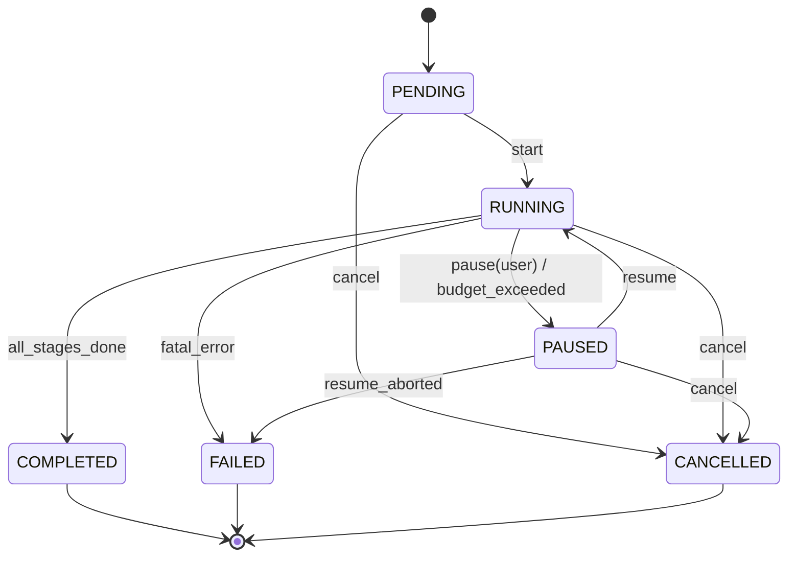
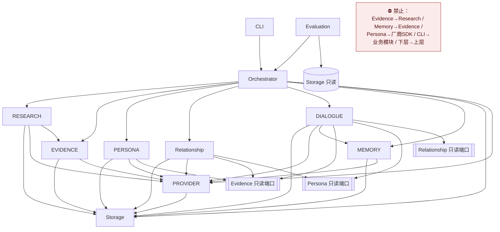

# INTERFACES —— 模块接口契约

- **版本**：v0.1.6（P1.2-A 契约 + P1.2-B 验收同步 + P2.3 实现状态 + P4 集成回填 + H-11A Research 实现状态 + H-10A 业务编排器 + G-2 自动抽取）
- **状态**：主体待人工验收；§1.8 闸门说明按 R-3 已同步为「双层闸门」；**§12.6 为 P2.3 新增**；**§8.1 的 `MemoryReader` 端口与 §8.2 的写入/检索触发规则为 P4 集成回填（D-185）**；**§5.3 为 H-11A Research 实现状态回填（D-196）**；**§5.4 为 G-2 自动抽取新增（D-221）**；**§12.7 为 H-10A 业务编排器新增（D-206）**
- **运行环境**：Python 3.12+ / 本地 CLI / 模块化单体 / SQLite
- **相关文档**：`ARCHITECTURE.md`、`DATA_MODEL.md`、`ERROR_HANDLING.md`、`DECISIONS.md`、`PROJECT_SPEC.md`

> **本阶段只定义契约。不实现业务逻辑、不安装依赖、不初始化数据库、不调用真实外部服务。**
> 文中的类型标注是 Python 3.12 语法，用于表达"输入什么、输出什么"，实现时可用 `dataclasses` 承载。

---

## 0. 怎么读这份文档

| 你是谁 | 建议读法 |
| --- | --- |
| 要实现某个模块的开发者 | 先读 §1 公共契约，再读你负责的那一节，最后读 §13 依赖约束 |
| 要写测试的开发者 | 读每个操作的「失败」列（这就是测试用例清单）+ §10 Evaluation |
| 想改接口的人 | 先读 `DECISIONS.md` §4 变更流程，本文 §17 留痕 |

**全篇通用的三条规则**：

1. 跨模块调用**一律返回 `Result` 信封**（§1.4），跨模块边界**不得抛业务异常**。
2. 跨模块**只传递 `Ref` / `View` / `Draft`**，不传递数据库内部记录（§1.6）。
3. 每个操作**必须声明**是否读写数据库、是否调用外部 API、是否消耗预算。没声明即视为不允许。

---

## 1. 跨模块公共契约

### 1.1 标识（ID）规则

| 规则 | 内容 |
| --- | --- |
| 生成 | `uuid4()` 十六进制字符串 + 业务前缀，前缀见 `DATA_MODEL.md` §2.1 |
| 不可变 | ID 一经生成永不改变，不因排序、版本、业务含义而改写 |
| 不可猜测 | 禁止顺序自增整数；对外展示可另设 `display_code` |
| 校验格式 | `assert id.startswith(prefix)` 且长度为 `len(prefix) + 32` |

**ID 关联总表**（回答"这些 ID 怎么串起来"）：

```
project_id
   ├── entity_ids[]                ← PersonEntity.id
   ├── Source.project_id            ← Source.id
   │      └── SourceEvent.source_id ← SourceEvent.id
   │             └── EvidenceItem.source_event_ids[] ← EvidenceItem.id
   ├── EvidenceItem.subject_entity_ids[] → PersonEntity.id
   ├── PersonaProfile.entity_id     → PersonEntity.id
   ├── RelationshipProfile.participant_entity_ids[] → PersonEntity.id
   ├── ConversationSession.id
   │      └── ConversationTurn.session_id
   │             └── MemoryItem.source_turn_id
   ├── TaskRecord.project_id        ← 唯一持有 checkpoints 的实体
   │      └── checkpoint.artifact_ids{ source_ids[], evidence_ids[],
   │             persona_ids[], relationship_ids[], session_id[] }
   ├── DerivedArtifact.source_memory_ids[] → MemoryItem.id
   └── CharacterInstance.character_id → PersonEntity.id   （P8.1-B）
          └── story_id = sty_（故事锚，多个实例归同一场故事；
              profile_version 钉住 PersonaProfile 版本；
              knowledge[id=kn_] / relationship_state 内嵌 payload）
```

> **没有任何模块跨步骤"手递手"传大对象**，只传 ID。产出落盘到 `Storage`，下游按 ID 取。这就是断点续跑能成立的原因。

### 1.2 时间表示

| 场景 | 约定 |
| --- | --- |
| 精确时间戳 | UTC `datetime`，序列化为 ISO-8601（`2026-10-13T12:00:00Z`） |
| 模糊时间 | 用 `FuzzyDate{raw, start, end, precision}`，见 `DATA_MODEL.md` §2.3 |
| 禁止 | 把 "九十年代初" 这类值塞进单个 `datetime` 字段 |
| 单调性校验 | `created_at <= updated_at`；`expires_at > valid_from` |

### 1.3 调用上下文 `CallContext`

每个跨模块操作的**第一个参数**，用于追踪、计量与幂等。

```python
@dataclass(frozen=True)
class CallContext:
    project_id: str
    actor: str                 # 调用方模块名：research / evidence / persona / ...
    task_id: str | None        # 所属任务；为空表示该操作不在任务预算内
    budget_scope: str          # 预算归属，通常 == task_id
    trace_ref: str             # 贯穿日志与错误的追踪 ID
    idempotency_key: str | None
    dry_run: bool = False      # 只校验不落盘；必须无副作用
```

**规则**：没有 `CallContext` 的操作不得写库，也不得调用 Provider。这条让"谁改了什么"天然可审计。

### 1.4 结果信封 `Result[T]`

```python
Result = Ok[T] | Err

@dataclass
class Ok(Generic[T]):
    value: T
    warnings: list[Warning] = field(default_factory=list)   # 业务提示，不是失败
    usage: UsageDelta | None = None                          # 本次消耗可能有也可能无

@dataclass
class Err:
    error: AppError

@dataclass(frozen=True)
class AppError:
    code: str            # 例：EXTERNAL_RATE_LIMIT
    category: ErrorCategory
    message: str
    retryable: bool
    recoverable: bool    # 是否可通过 resume 继续
    trace_ref: str
    details: dict = field(default_factory=dict)
```

**为什么用信封而不是异常**：把"失败"变成返回值的正常分支，调用方**不可能忘记处理**。异常只留给程序缺陷（§1.5）。

### 1.5 三类结果的区分（必须严格）

| 类别 | 是什么 | 怎么用 | 例子 |
| --- | --- | --- | --- |
| **业务结果** | 操作成功，但业务上"没找到 / 不够 / 有分歧" | 进 `Ok(...)`，用返回值字段或 `warnings` 表达。**任务继续** | 搜索 0 条结果；某人 `INSUFFICIENT_EVIDENCE`；检测到 3 处冲突 |
| **运行错误** | 环境/外部/存储出了问题，重试可能成功 | 进 `Err(AppError)`，`retryable=True` | 超时、限流、服务 503、SQLite 锁 |
| **验证错误** | 输入或数据不合规，重试没用 | 进 `Err(AppError)`，`retryable=False` | `namespace` 非法、缺 `derived_from`、`stability=SINGLE` 却要进 traits |
| **程序缺陷** | 不该发生（空指针、断言失败） | 抛 Python 异常，写 `trace_ref`，**任务置 FAILED** | 违反 INV-1~INV-4 的不变式 |

> ⚠️ **冲突、资料不足、查不到结果都不是错误。** 把它们当错误会导致流程脆弱，也会诱导后来者"悄悄合并"或"悄悄补全"来消除错误。

错误分类细则与重试参数见 `ERROR_HANDLING.md` §2、§3。

### 1.6 DTO 与数据库记录的分离

| 类型 | 用途 | 能否跨模块传递 |
| --- | --- | --- |
| `*Record` | 数据库行，含内部列（行锁、软删标记、内部索引） | ⛔ **只能在所属模块内部使用** |
| `*Ref` | `{id}` + 2~4 个展示字段，用于跨模块引用 | ✅ 默认选择 |
| `*View` | 只读完整视图（不含内部列） | ✅ 需要完整内容时 |
| `*Draft` | 创建/更新输入 | ✅ |
| `*Query` | 查询条件 + 分页 | ✅ |
| `Page[T]` | `{items, total, has_more}` | ✅ |

**执行约束**：任何模块的**公开函数签名**中不得出现 `*Record`。由 `check_dependencies` 静态扫描签名拦截。

### 1.7 分页与过滤约定

```python
@dataclass
class Query:
    filters: dict              # 由各模块定义白名单键，未知键直接 VALIDATION 拒绝
    limit: int = 50            # 上限 200
    offset: int = 0
    sort: tuple[str, str] | None = None   # ("created_at", "asc")

@dataclass
class Page(Generic[T]):
    items: list[T]
    total: int
    has_more: bool
```

`limit > 200` → `Err(VALIDATION.limit_too_large)`。

### 1.8 命名空间写入闸门

所有写操作在创建时强制校验 `namespace`，**非法取值在进入业务逻辑之前就被拒绝**：

| 目标实体 | 允许写入的 namespace | 强制闸门位置 |
| --- | --- | --- |
| `Source` / `SourceEvent` | 仅 `PUBLIC_SOURCE` | `Evidence.register_source` / `Evidence.extract_events` |
| `EvidenceItem` | `PUBLIC_SOURCE`、`SYSTEM_DERIVED`（仅 INFERENCE）、`USER_PROVIDED`（经 UserInputRecord） | `Evidence.add_evidence` / `Evidence.record_inference` |
| `PersonaProfile` / `RelationshipProfile` | 仅 `SYSTEM_DERIVED` | `Persona.distill` / `Relationship.distill` |
| `ConversationTurn` / `ConversationSession` | **固定** `SIMULATED`，不可传参覆盖 | `Dialogue.commit_turn` |
| `MemoryItem` | 全部四个，但必须与 `source_type` 自洽 | `Memory.write` |

#### 1.8.1 闸门是**双层**的：模块接口层 + 存储结构层（R-3 确认）

上表的「强制闸门位置」指**模块接口层**闸门：业务模块在调用 `Storage` 之前就必须校验，并向调用方返回
`Err(VALIDATION.namespace_forbidden)` 等可读错误。

除此之外，**`Storage.put` 还有第二层闸门**（P1.2-B 实现，经用户 R-3 确认保留）：

| 层 | 位置 | 作用 | 为什么不冲突 |
| --- | --- | --- | --- |
| 第一层（业务） | 各模块接口 | 判断「这个操作**该不该**发生」，给出可读错误与提示 | 负责语义与用户体验 |
| 第二层（结构） | `Storage.put` | 判断「这个 `(实体种类, namespace)` 组合**在不在允许表里**」，不在就直接拒绝写入 | **只做静态查表，不做业务判断** |

**为什么第二层不属于「业务判断」**（对应 `INTERFACES.md` §9 与 D-030：`Storage` 不做业务判断）：

1. 它**只查一张静态声明表**（`NAMESPACE_WRITE_GATE`：实体种类 → 允许的 namespace 集合），
   表里没有的就直接拒绝。**没有**任何条件分支去推断「这条数据意味着什么」。
2. 它**不改变、不补全、不修正**任何数据——要么原样写入，要么原样拒绝。
3. 它的性质等价于**外键约束 / CHECK 约束 / 非空约束**：由 schema 声明，由存储层强制执行。
   把「`EvidenceItem` 不得带 `SIMULATED`」交给调用方自觉，等于把 INV-2 变成口头约定。
4. 因此它不是「替模块做决定」，而是**让非法写入在物理上无法发生**（fail-closed）。

**分工边界**：模块层闸门负责「解释为什么不行」，存储层闸门负责「保证它一定不行」。
两者缺一不可；后续 P2 补齐模块实现时，**两层都要在**，不得因为有了存储层闸门就删掉模块层校验。

**新增实体种类时**：必须同时更新 `NAMESPACE_WRITE_GATE` 与本节表格，否则新实体一律写不进去（**默认拒绝**）。

---

## 2. Provider —— 外部服务统一接口

### 2.1 职责与非职责

| 项 | 内容 |
| --- | --- |
| **职责** | 把模型调用与检索调用包装成统一的两个方法；统一记账、超时、限流、重试、错误归一 |
| **非职责** | ⛔ 不做提示词编排（提示词在调用方模块内）；⛔ 不做业务判断；⛔ 不写业务表（只写用量与审计）；⛔ 不自行决定降级策略 |
| **可调用** | ✅ `Storage`（写用量与审计） ⛔ 其他一切 |

> **`Provider` 是唯一的外部出口。** 任何其他模块若出现 `import httpx / openai / requests` 或读取 API Key，视为违规。

### 2.2 能力描述

```python
@dataclass(frozen=True)
class CapabilitySet:
    provider_name: str            # "fake" / "recording" / "http-adapter"（本期不实现）
    supports_chat: bool
    supports_search: bool
    supports_structured_output: bool   # 能否按 JSON Schema 返回
    max_context_tokens: int | None
    max_output_tokens: int | None
    languages: list[str]
    rate_limit_per_minute: int | None
    cost_model: str | None        # "per-token" / "per-call" / "unknown"

capabilities() -> Ok[CapabilitySet]
```

调用方**必须先查能力再决定策略**：不支持 `structured_output` 时，上层退回文本解析 + 严格校验，并在 `warnings` 里说明。

### 2.3 主要操作

#### `chat(ctx, req: ChatRequest) -> Result[ChatResponse]`

| 项 | 内容 |
| --- | --- |
| 输入 | `ChatRequest{ messages: list[Message], model_hint: str \| None, response_format: "text" \| "json_schema", json_schema: dict \| None, temperature: float, max_output_tokens: int, stop: list[str], timeout_ms: int, metadata: dict }` |
| 输出 | `Ok(ChatResponse{ text, structured: dict \| None, finish_reason, model_id, usage: UsageDelta, raw_ref: str })` |
| 失败 | `VALIDATION`（消息为空 / `json_schema` 与 `response_format` 不匹配 / `max_output_tokens` 超能力）、`EXTERNAL_TIMEOUT`、`EXTERNAL_RATE_LIMIT`、`EXTERNAL_AUTH`、`EXTERNAL_UNAVAILABLE`、`EXTERNAL_QUOTA`、`BUDGET_EXCEEDED` |
| 副作用 | DB：写 `UsageRecord`、`AuditRecord`；外部：模型服务；预算：✅ 计入 `requests / tokens_in / tokens_out / latency_ms` |
| 重试 | 可重试错误由 Provider **内部**按 §2.5 策略重试；**对外**该操作整体幂等要求携带 `ctx.idempotency_key` |
| 隔离 | Provider 不理解业务语义；`metadata` 只做透传不得携带业务判断结果 |

#### `search(ctx, req: SearchRequest) -> Result[SearchResponse]`

| 项 | 内容 |
| --- | --- |
| 输入 | `SearchRequest{ query: str, language: str \| None, limit: int, filters: {source_kinds?, date_from?, date_to?, entity_hints?}, timeout_ms: int }` |
| 输出 | `Ok(SearchResponse{ results: list[SearchResult], usage: UsageDelta })`，`SearchResult{title, url, canonical_key, snippet, published_at, source_kind_guess}` |
| 失败 | 同上 + `VALIDATION.query_empty`（空查询不得发起调用） |
| 副作用 | DB：写 `UsageRecord`；外部：检索服务；预算：✅ |
| 重试 | 同 chat |
| 隔离 | **Provider 不得缓存跨项目的检索结果**，避免污染；结果不含任何业务结论 |

#### `usage(ctx, scope: str) -> Result[UsageReport]`

| 项 | 内容 |
| --- | --- |
| 输入 | `scope` = `task_id` 或 `project_id` |
| 输出 | `Ok(UsageReport{ requests, tokens_in, tokens_out, latency_ms_total, cost_estimate, currency, breakdown_by_actor: dict })` |
| 失败 | `NOT_FOUND.scope_unknown`、`STORAGE.read_failed` |
| 副作用 | DB：**只读**；外部：无；预算：无 |
| 重试 | `STORAGE.read_failed` 可重试；其余不可 |
| 隔离 | 只读，不改变任何业务状态 |

#### `health(ctx) -> Result[HealthStatus]`

| 项 | 内容 |
| --- | --- |
| 输入 | 无 |
| 输出 | `Ok(HealthStatus{ reachable: bool, degraded: bool, last_error_code: str \| None, checked_at })` |
| 失败 | **不失败**——`health()` 永远返回 `Ok`，不可达用 `reachable=False` 表达 |
| 副作用 | 外部：轻量探测（若 provider 支持）；DB：无；预算：**不计入**（探测不计成本） |
| 重试 | 不适用 |

### 2.4 用量记录规则

```python
@dataclass
class UsageDelta:
    requests: int = 1
    tokens_in: int | None = None      # 未知必须为 None，禁止猜估值
    tokens_out: int | None = None
    latency_ms: int = 0
    cost_estimate: float | None = None
    currency: str = "UNKNOWN"
```

- **至少**记录 `requests` 与 `latency_ms`；token/金额未知时留 `None`，**绝不填估计值**。
- 记账发生在**调用返回后、返回给调用方之前**，且在同一个 `Storage` 事务里。
- 预算超限后的下一次调用必须**在发出之前**被拦截（`ERROR_HANDLING.md` §4）。

### 2.5 错误处理与重试

| 错误码 | 类别 | 可重试 | Provider 内部策略 | 任务影响 |
| --- | --- | --- | --- | --- |
| `EXTERNAL_TIMEOUT` | 外部 | ✅ | 指数退避重试，最多 `max_retries`（默认 3），需幂等键 | 超上限则上报，任务按策略暂停或失败 |
| `EXTERNAL_RATE_LIMIT` | 外部 | ✅ | 尊重响应中的 `retry_after`；无则退避 | 同上 |
| `EXTERNAL_UNAVAILABLE` | 外部 | ✅ | 指数退避重试 | 同上 |
| `EXTERNAL_AUTH` | 外部 | ⛔ | 不重试 | 任务 FAILED（配置问题，非暂时性） |
| `EXTERNAL_QUOTA` | 外部 | ⛔ | 不重试 | 任务 FAILED 并告警 |
| `VALIDATION.*` | 验证 | ⛔ | 不重试 | 调用方缺陷；任务 FAILED |
| `BUDGET_EXCEEDED` | 预算 | ⛔ | 不重试 | **任务转 PAUSED**（见 `ERROR_HANDLING.md` §4） |

**重试配置位置**：`ProviderConfig{ max_retries=3, backoff_base_ms=500, backoff_max_ms=8000, jitter=True, per_call_timeout_ms=30000, respect_retry_after=True }`。
配置由 `Orchestrator` 在创建任务时注入，**Provider 自身不持有全局可变默认值**。

退避公式：`delay = min(backoff_max_ms, backoff_base_ms * 2**attempt)` 并加随机抖动。

### 2.6 Mock Provider 家族（本阶段唯一可用实现）

| 实现 | 行为 | 用途 |
| --- | --- | --- |
| `FakeProvider` | 按 `(capability, fixture_key)` 返回**固定**结果，完全确定性 | 单元测试、集成测试 |
| `RecordingProvider` | 包装任意 provider，记录每次请求/响应到 `call_log` | 回放测试、回归对比 |
| `FailingProvider` | 按脚本注入指定错误码（含超预算、限流、鉴权失败） | 错误路径测试 |
| `OfflineGuardProvider` | 包装任意 provider，一旦发生真实网络调用立即抛错 | 保证测试真离线 |

**替换机制**：`ProviderRegistry.get(name, config) -> Provider`，由配置选择；**测试环境与生产代码走同一份接口**，不存在"测试专用分支"。
`fixture_key` 必须由调用方显式给出，**禁止用请求内容做模糊匹配**返回不同结果（否则测试不稳定）。

---

## 3. Storage —— 持久化

### 3.1 职责与非职责

| 项 | 内容 |
| --- | --- |
| **职责** | 事务、CRUD、软删除、引用完整性检查、审计日志、用量表、检查点读写 |
| **非职责** | ⛔ **不做业务判断**（不判断 tier 是否合法、不判断是否冲突）；⛔ 不做排序/打分逻辑；⛔ 不调用任何外部服务 |
| **可调用** | ⛔ 无（最底层） |

> **Storage 不负责业务判断**——这条是为了防止"在 SQL 里偷偷合并冲突"或"在写入时偷偷降级"。所有语义决策发生在各自的领域模块里。

### 3.2 主要操作

| 操作 | 签名要点 | 输入 | 输出 | 失败 | DB/外部/预算 | 重试 |
| --- | --- | --- | --- | --- | --- | --- |
| `transaction` | `transaction(ctx, fn)` | 回调 | `Ok(fn 的返回值)` | 回调返回的 `Err` 或 `STORAGE.*` | DB 事务 / 无 / 无 | 回调幂等则可重试 |
| `put` | `put(ctx, kind, record)` | 实体种类 + Record | `Ok(id)` | `STORAGE.write_failed`、`STORAGE.conflict`、`VALIDATION.reference_missing` | DB 写 / 无 / 无 | 幂等键存在则可重试 |
| `get` | `get(ctx, kind, id)` | id | `Ok(record)` 或 `Ok(None)` | `STORAGE.read_failed` | DB 读 / 无 / 无 | 可重试 |
| `query` | `query(ctx, kind, q: Query)` | Query | `Ok(Page[record])` | `VALIDATION.unknown_filter`、`STORAGE.read_failed` | DB 读 / 无 / 无 | 可重试 |
| `update` | `update(ctx, kind, id, patch)` | 补丁 | `Ok(record)` | `NOT_FOUND`、`STORAGE.conflict`（乐观锁失败）、`VALIDATION.immutable_field` | DB 写 / 无 / 无 | 幂等则可重试 |
| `soft_delete` | `soft_delete(ctx, kind, id)` | id | `Ok(None)` | `NOT_FOUND`、`STORAGE.write_failed` | DB 软删 + 审计 / 无 / 无 | 幂等则可重试 |
| `check_references` | `check_references(ctx, kind, ids)` | id 列表 | `Ok(ReferenceReport{missing: list[str]})` | `STORAGE.read_failed` | DB 读 / 无 / 无 | 可重试 |
| `save_checkpoint` | `save_checkpoint(ctx, task_id, Checkpoint)` | 检查点 | `Ok(resume_token)` | `STORAGE.write_failed`、`NOT_FOUND.task` | DB 写 / 无 / 无 | 幂等（同一 token 覆盖） |
| `load_checkpoint` | `load_checkpoint(ctx, task_id)` | task_id | `Ok(Checkpoint \| None)` | `STORAGE.read_failed` | DB 读 / 无 / 无 | 可重试 |
| `record_usage` | `record_usage(ctx, UsageRecord)` | 用量 | `Ok(None)` | `STORAGE.write_failed` | DB 写 / 无 / 无 | 幂等键存在则可重试 |
| `append_audit` | `append_audit(ctx, AuditRecord)` | 审计 | `Ok(audit_id)` | `STORAGE.write_failed` | DB 写 / 无 / 无 | 可重试 |

**统一约束**：

- 所有写操作记录 `created_by = ctx.actor`、`trace_ref = ctx.trace_ref`。
- 软删除后 `get` 默认不返回被删记录（需显式 `include_deleted=True`）。
- `Storage.` 前缀的错误**一律不含业务含义**，只描述"这次读写有没有成功"。

### 3.3 SQLite 约定（第一版）

| 项 | 约定 |
| --- | --- |
| 连接 | Python 标准库 `sqlite3`，文件位于 `<project_root>/.data/<project_id>.db` |
| 事务 | `BEGIN IMMEDIATE`；单个任务独占写连接 |
| 并发 | WAL 模式；读可并发，写串行 |
| 关键词索引 | `FTS5` + `trigram` 分词器（SQLite ≥ 3.34，零第三方依赖），用于记忆检索 |
| 迁移 | `schema_version` 递增 + 迁移脚本；禁止自动删表 |
| 导出 | 提供 JSON 导出，纯文件可读，便于排障 |

---

## 4. Evidence —— 证据登记、分级、去重、冲突

### 4.1 职责与非职责

| 项 | 内容 |
| --- | --- |
| **职责** | 来源登记与去重、来源事件切分、证据原子化、定级、去重归并、冲突记录、稳定性判定、推断登记 |
| **非职责** | ⛔ **不得自行启动研究循环**（禁止暴露任何基于检索或循环抓取的操作；只处理调用方交给它的内容）；⛔ 不做检索（不调用 `Provider.search`）；⛔ 不裁决冲突；⛔ 不写任何记忆或档案 |
| **可调用** | ✅ `Storage` ✅ `Provider.chat`（仅用于对已有文本做抽取/分类） ⛔ `Provider.search` ⛔ 其他业务模块 |

> **约束落地**：`Evidence` 的公开签名里**不存在任何返回 `SearchResult` 或接受 `query` 的方法**。要找资料必须走 `Research`。

### 4.2 主要操作

#### `register_source(ctx, draft: SourceDraft) -> Result[SourceRef]`

| 项 | 内容 |
| --- | --- |
| 输入 | `SourceDraft{ title, url, canonical_key, content_hash, kind, publisher, author, published_at, language, reliability, source_family_id, role_in_family, content_ref, access_note }` |
| 输出 | `Ok(SourceRef{id, title, kind, reliability})`；**命中去重时返回已存在的 id** 并附 `warnings=[SOURCE_DEDUP_HIT]` |
| 失败 | `VALIDATION.required_field`、`VALIDATION.namespace_forbidden`（`namespace != PUBLIC_SOURCE`）、`STORAGE.write_failed` |
| 副作用 | DB：写 `Source` + `AuditRecord`；外部：无；预算：无 |
| 重试 | 幂等（`ctx.idempotency_key`）→ 可重试 |
| 隔离 | 只接受 `PUBLIC_SOURCE`；用户输入不得经此进入 |

#### `extract_events(ctx, source_id, min_granularity) -> Result[list[SourceEventRef]]`

| 项 | 内容 |
| --- | --- |
| 输入 | `source_id`、`min_granularity: "document" \| "section" \| "timestamp"` |
| 输出 | `Ok([SourceEventRef{id, title, event_type, locator, real_world_date, canon_level}])`；若来源不可切分则返回**单个覆盖全文的事件**并 `warnings=[EVENT_SINGLE_BLOCK]` |
| 失败 | `NOT_FOUND.source`、`VALIDATION.granularity_unsupported`、`EXTERNAL_*`（仅当使用 `Provider.chat` 辅助切分时）、`BUDGET_EXCEEDED` |
| 副作用 | DB：写 `SourceEvent` + 审计；外部：可选 `Provider.chat`；预算：✅ 仅当调用 chat 时 |
| 重试 | 同一 `source_id` + 幂等键重试**不得**重复建事件（以 `event_signature` 去重） |
| 隔离 | `namespace` 固定 `PUBLIC_SOURCE`；**AI 不得生成 `SourceEvent`**，此路径不对外开放给 Dialogue |

#### `add_evidence(ctx, draft: EvidenceDraft) -> Result[EvidenceRef]`

| 项 | 内容 |
| --- | --- |
| 输入 | `EvidenceDraft{ claim, tier, dimension, subject_entity_ids, source_id, source_event_ids, locator, verbatim_quote, stated_at, stability, extraction_confidence, canon_level, applicable_variant_ids, tags }` |
| 输出 | `Ok(EvidenceRef{id, claim, tier, source_id, stability, status})` |
| 失败 | `VALIDATION.tier_quote_missing`（`VERBATIM` 无原文）、`VALIDATION.tier_namespace_mismatch`（`PUBLIC_SOURCE` 却给了 `INFERENCE`）、`VALIDATION.source_missing`、`VALIDATION.entity_missing`、`STORAGE.write_failed` |
| 副作用 | DB：写 `EvidenceItem` + 审计；外部：无；预算：无 |
| 重试 | 幂等键存在则可重试 |
| 隔离 | ⛔ **拒绝 `namespace = SIMULATED`**，在任何业务校验之前就拒绝 |

#### `record_inference(ctx, draft: InferenceDraft) -> Result[EvidenceRef]`

| 项 | 内容 |
| --- | --- |
| 输入 | `InferenceDraft{ claim, derived_from_evidence_ids, dimension, subject_entity_ids, confidence, reasoning_note }` |
| 输出 | `Ok(EvidenceRef)`，`tier=INFERENCE`、`namespace=SYSTEM_DERIVED` |
| 失败 | `VALIDATION.no_derivation`（`derived_from` 为空 → **无根推断被拒**）、`VALIDATION.dangling_reference`、外部错误 |
| 副作用 | DB：写 `EvidenceItem` + 审计；外部：可选 `Provider.chat`；预算：✅ 仅当用模型生成时 |
| 重试 | 可重试 |
| 隔离 | `source_id` 必须为 `None`；**推断永不得伪装成来源中的直接陈述**（输出里 `tier` 恒为 `INFERENCE`） |

#### `detect_duplicates(ctx, scope) -> Result[list[DedupeGroupRef]]`

| 项 | 内容 |
| --- | --- |
| 输入 | `scope{project_id, entity_ids?}` |
| 输出 | `Ok([DedupeGroupRef{id, canonical_claim, member_evidence_ids, member_source_ids, merge_method}])` |
| 失败 | `STORAGE.read_failed`、外部错误（若用模型辅助判定相似度） |
| 副作用 | DB：写去重组关系；外部：可选 chat；预算：✅ 视实现 |
| 重试 | 可重试；结果幂等 |
| 隔离 | **只归并说法，保留全部来源引用**；不得删除任何 `EvidenceItem` |

#### `detect_conflicts(ctx, scope) -> Result[list[ConflictRef]]`

| 项 | 内容 |
| --- | --- |
| 输入 | `scope{project_id, entity_ids?, topic_hint?}` |
| 输出 | `Ok([ConflictRef{id, topic, divergence_kind, member_count, review_status}])`，未发现冲突返回**空列表**（不是错误） |
| 失败 | `STORAGE.read_failed`、外部错误 |
| 副作用 | DB：写 `ConflictRecord` + 回写 `EvidenceItem.conflict_ids` + 证据标 `DISPUTED`；外部：可选 chat；预算：✅ 视实现 |
| 重试 | 可重试；冲突记录**只增不删** |
| 隔离 | **禁止删除或合并任何一方说法**；`review_status` 只能是 `UNREVIEWED`/`ACKNOWLEDGED` |

#### `judge_stability(ctx, subject_entity_id, claim_text, evidence_ids) -> Result[StabilityVerdict]`

| 项 | 内容 |
| --- | --- |
| 输入 | 对象 ID、待判定说法、支撑证据列表 |
| 输出 | `Ok(StabilityVerdict{stability: SINGLE\|REPEATED\|PATTERN\|UNKNOWN, occurrences, distinct_sources, time_span, reason})` |
| 失败 | `VALIDATION.empty_evidence`、`STORAGE.read_failed` |
| 副作用 | DB：**只读**（不改证据）；外部：无；预算：无 |
| 重试 | 可重试 |
| 隔离 | 这是保护性闸门：**`SINGLE` 的说法被禁止进入 `Persona.traits`** |

#### `query_evidence(ctx, q: EvidenceQuery) -> Result[Page[EvidenceView]]`

只读查询；供 `Persona` / `Relationship` / `Dialogue`(只读端口) / `CLI` 使用。
`EvidenceQuery` 支持按 `entity_ids`、`tier`、`dimension`、`stability`、`status`、`conflict_ids`、`canon_level`、`applicable_variant_ids` 过滤。

**返回必然包含**：`namespace`、`source_id`、`source_event_ids`、`conflict_ids` —— 下游无法忽略归属信息。

### 4.3 数据隔离与安全约束

| 约束 | 落地方式 |
| --- | --- |
| 不得接受 `SIMULATED` 证据 | `add_evidence` 首行校验；测试断言全表无 `SIMULATED` |
| 不得自行检索 | 公开签名中无 `query`/`search` 类方法；`check_dependencies` 拦截 `Provider.search` 调用 |
| 冲突不得抹平 | `ConflictRecord` 无 `RESOLVED`；无删除 member 的操作 |
| 虚构作品与 AI 生成分离 | `SourceEvent.canon_level` 与 `applicable_variant_ids` 必由真实来源登记；AI 侧无创建 `SourceEvent` 的路径 |

---

## 5. Research —— 资料搜集

### 5.1 职责与非职责

| 项 | 内容 |
| --- | --- |
| **职责** | 生成检索计划、执行检索、过滤排序、把候选来源交给 `Evidence` 登记 |
| **非职责** | ⛔ 不做证据分级（交 `Evidence`）；⛔ 不做人物蒸馏；⛔ **不直接写 `Source` / `EvidenceItem` 表**，一律经 `Evidence` 接口；⛔ 不做人物去歧的最终裁决 |
| **可调用** | ✅ `Provider.search`（✅ `Provider.chat` 仅在需要重写检索词时，见 Q-29） ✅ `Storage`（只写自身的过程记录） ✅ `Evidence`（登记） ⛔ 其他业务模块 |

### 5.2 主要操作

#### `plan_queries(ctx, targets: list[PersonQueryTarget]) -> Result[list[PlannedQuery]]`

| 项 | 内容 |
| --- | --- |
| 输入 | `PersonQueryTarget{entity_id, display_name, aliases, entity_type, work_titles?, adaptation_version?, topic?}` |
| 输出 | `Ok([PlannedQuery{query_text, language, intent, budget_cost_estimate, target_entity_ids}])` |
| 失败 | `VALIDATION.empty_targets`、`VALIDATION.entity_missing`；若使用 chat 则可能有 `EXTERNAL_*` / `BUDGET_EXCEEDED` |
| 副作用 | DB：写 `TaskRecord` 子阶段进度（可选）；外部：可选 chat；预算：✅ 仅当用 chat |
| 重试 | 可重试 |
| 隔离 | 检索词可含人名与作品名，**不得内嵌任何预设结论** |

#### `collect(ctx, planned_query) -> Result[CollectOutcome]`

| 项 | 内容 |
| --- | --- |
| 输入 | `PlannedQuery` |
| 输出 | `Ok(CollectOutcome{results: list[SearchResult], usage, fetch_status})`；**0 结果返回 `Ok` 且 `fetch_status=NO_RESULT`**，不是错误 |
| 失败 | `EXTERNAL_TIMEOUT` / `EXTERNAL_RATE_LIMIT` / `EXTERNAL_AUTH` / `EXTERNAL_UNAVAILABLE` / `EXTERNAL_QUOTA` / `BUDGET_EXCEEDED` / `VALIDATION.query_empty` |
| 副作用 | DB：无（不落来源）；外部：`Provider.search`；预算：✅ |
| 重试 | Provider 内部退避；整体可重试（需幂等键） |
| 隔离 | 只拿公开资料；**不触碰任何 SIMULATED 或 USER_PROVIDED 内容** |

#### `filter_and_rank(ctx, results) -> Result[RankedCandidates]`

| 项 | 内容 |
| --- | --- |
| 输入 | `list[SearchResult]` |
| 输出 | `Ok(RankedCandidates{accepted: [...], rejected: [{result, reason}], warnings})` |
| 失败 | `VALIDATION.empty_input`（不算失败，返回空 accepted + warning）、`STORAGE.read_failed` |
| 副作用 | DB：**只读**；外部：无；预算：无 |
| 重试 | 可重试 |
| 隔离 | 保留合规检查位（白/黑名单、robots / ToS），规则待定 Q-02；**被拒绝项必须记录原因** |

#### `register(ctx, ranked) -> Result[ResearchRegisterOutcome]`

| 项 | 内容 |
| --- | --- |
| 输入 | `RankedCandidates` |
| 输出 | `Ok(ResearchRegisterOutcome{source_ids, dedup_hits, event_ids, registered_count})` |
| 失败 | 透传 `Evidence.*` 的验证/存储错误 |
| 副作用 | DB：经 `Evidence` 写 `Source` / `SourceEvent` + 审计；外部：无；预算：无 |
| 重试 | 幂等：同一批来源重复注册只会命中去重，不会重复建记录 |
| 隔离 | 只产生 `PUBLIC_SOURCE` 数据 |

#### `run(ctx, targets, budget) -> Result[ResearchOutput]`

主入口：串起 plan → collect → filter → register。**每个 `PlannedQuery` 完成后写一次检查点**。
返回 `ResearchOutput{source_ids, event_ids, planned_count, executed_count, no_result_count, budget_used, warnings}`。

| 失败 | 说明 |
| --- | --- |
| `BUDGET_EXCEEDED` | 触发任务 PAUSED（不是失败） |
| `EXTERNAL_*` 全部查询均失败 | 上报；由 Orchestrator 决定是否 FAILED |
| 单个查询失败 | **记录并继续其他查询**，进入 `warnings`，任务不失败 |

### 5.3 实现状态与边界（H-11A 回填，2026-10-14）

> `persona/modules/research.py` 已由「只有 Protocol」推进为**可执行、可测试的最小实现**
> （`ResearchService`）。本节记录**实现相对契约的取舍**，供人工验收（D-191 ~ D-205）。

| 项 | 实现口径 |
| --- | --- |
| **已实现** | `plan_queries`（确定性模板，不调模型）/ `collect`（经 `Provider.search`）/ `filter_and_rank`（去无效 + 批内去重 + 确定性排序）/ `register`（经 `Evidence.register_source`）/ `run`（串起四步，聚合计数与 `warnings`） |
| **未实现** | 真实检索接入（仍是 `Provider` 抽象 + Mock）、检索词语义改写/多语言扩展、相关性语义排序、正文抓取与切分（`content_ref` / `snapshot_ref` 留空）、`SourceEvent` 产出（交 `Evidence`） |
| **写权限** | 只注入 `SourceRegistrarPort`（**只有 `register_source`**），模块内**无** `Storage` / 无 `sqlite3` / 无 `add_evidence`——F-10「Research → Evidence 表直接写入」在类型层面被堵死 |
| **不承担的职责** | 任务六态机、预算账本、检查点（**均为 Orchestrator 职责**）。`run(ctx, targets, budget=None)` 的 `budget` 仅为签名兼容而保留，**不查询、不扣减**；返回的 `budget_used` 是 Provider 如实回报的用量之和 |
| **签名扩展** | `filter_and_rank(ctx, results, *, target_entity_ids=None)` 增加一个**可选关键字参数**，用于把对象边界（候选属于哪个 `PersonEntity`）带到 `Evidence`；不传时行为与原签名一致 |
| **`fetch_status=NO_RESULT`** | `FetchStatus` 枚举只有 OK/PARTIAL/FAILED/BLOCKED，**不含 `NO_RESULT`**。实现用模块级常量 `FETCH_NO_RESULT`（`"NO_RESULT"`）表达「检索成功但 0 条」，**不改动已审枚举** |
| **`VALIDATION.empty_targets`** | 契约把 `plan_queries` 空目标列为该码，但 `ERROR_HANDLING §2.2` / `ErrorCode` **未登记**；实现复用 `VALIDATION.required_field`，不新增错误码 |
| **校验下沉** | Research 只做**形状校验**（目标非空、`entity_id` / 名字齐备、查询非空）；「实体是否真实存在」由 `Evidence.register_source` 兜底（`VALIDATION.entity_missing`） |
| **G-2 追加：材料输出** | `ResearchOutput` / `ResearchRegisterOutcome` 新增 `materials: list[SourceMaterial]`（含检索摘要 `snippet`）。此前只返回 `source_ids`——来源元数据里没有材料正文，下游无从抽取 claim。**`SourceMaterial` 放在 `persona/core/types.py`**，以便 `L4 Research`（产出方）与 `L4 抽取器`（消费方）都能引用而不破同层互不调用的规则（ARCHITECTURE §3）。⚠️ `snippet` 只是检索摘要，**不是正文全文**（正文抓取未实现，H-17） |

### 5.4 来源材料 → 候选 claim 的抽取（G-2 新增，2026-10-14）

> `persona/modules/extraction.py`。⚠️ 仓库里有**两个** G-2：本节是
> `RUNNING.md` §5.12 那条（H-10A 遗留「源→证据自动抽取」）；`RUNNING.md` §5.8 的
> G-2 是 P3.3 遗留「群体子结构关系无法表达」，两者无关（Q-37 第十轮）。

**唯一入口**：

```python
class ClaimExtractorPort(Protocol):
    def extract(self, ctx, materials: list[SourceMaterial], *,
                targets: list[Any] | None = None) -> Result[ExtractionOutcome]: ...
```

| 数据形状 | 字段 |
| --- | --- |
| `SourceMaterial`（`core/types.py`） | `source_id` / `title` / `url` / `canonical_key` / **`snippet`** / `published_at` / `source_kind` / `subject_entity_ids` / `target_display_names` / `query_text` |
| `CandidateClaim` | `key` / `source_id` / `claim` / `tier` / `dimension` / `subject_entity_ids` / `confidence` / `verbatim_quote` / `locator` / `stated_at` / `stability` / `canon_level` / `derivation_keys` / `tags` / `note` |
| `RejectedClaim` | `reason` / `message` / `key` / `source_id` / `claim` |
| `ExtractionOutcome` | `claims` / `rejected` / `warnings` / `method` / `usage` |

**三种 claim 的机械区分**（推断不得伪装成原文引用）：

| 类型 | `tier` | 登记入口 | 硬约束 |
| --- | --- | --- | --- |
| 原文直接支持 | `VERBATIM`（带 `verbatim_quote`） | `Evidence.add_evidence` | 摘录必须能在材料的 `snippet` 里逐字找到，否则 `QUOTE_NOT_IN_MATERIAL` 拒收 |
| 对材料的归纳 | `PROFILE_BACKGROUND` / `THIRD_PARTY` | `Evidence.add_evidence` | 不得带 `verbatim_quote` 冒充原话 |
| 系统推断 | `INFERENCE` | `Evidence.record_inference` | 必须解析出 `derivation_keys` 对应的根证据，否则**丢弃**（EV-V3）；带摘录 → `INFERENCE_WITH_QUOTE` 拒收 |

**拒收原因**（全部进 `rejected`，**不静默丢弃**）：
`EMPTY_MATERIAL` / `EMPTY_CLAIM` / `NO_SUBJECT` / `QUOTE_NOT_IN_MATERIAL` /
`UNKNOWN_TIER` / `UNKNOWN_DIMENSION` / `CONFIDENCE_OUT_OF_RANGE` / `INFERENCE_WITH_QUOTE`。

**红线**：
- ⛔ 抽取器**拿不到** `Evidence`（不 import `evidence` 模块、无 `add_evidence` /
  `record_inference` 调用），结构上无法把候选直接标记成"已验证证据"；
- ⛔ 不裁决、不合并冲突：说法不同就各自保留成独立候选（AC-15）；
- ⛔ `tier` 沿用既有 `EvidenceTier` 定义，**等级不等于真实性**（D-009 / D-010）。

**实现**：

| 实现 | 说明 |
| --- | --- |
| `MockClaimExtractor` | 确定性离线查表（按 `canonical_key` 取 fixture），产出一律打 `mock-fixture` 标签，**清楚标识为测试材料** |
| `ProviderClaimExtractor` | **模型抽取的契约与错误处理**（本阶段不接真实模型）：`Provider.chat` 失败**原样传播**；返回非约定 JSON → `Err(EXTERNAL_UNAVAILABLE)`（不谎报"抽取成功但零结果"）；单条取值非法 → 记 `rejected` 并继续；缺 `material_key` → 无法溯源，拒收 |

---

## 6. Persona —— 人物档案蒸馏

### 6.1 职责与非职责

| 项 | 内容 |
| --- | --- |
| **职责** | 把某对象的证据集合蒸馏成结构化档案；执行稳定性闸门；缺证据时不补全而是记录 `open_questions` |
| **非职责** | ⛔ **不直接调用任何具体模型供应商**（只能通过 `Provider` 抽象，不得持有 API Key / SDK / base_url）；⛔ 不修改证据；⛔ 不做关系建模；⛔ 不写记忆；⛔ 不做检索 |
| **可调用** | ✅ `Storage` ✅ `Provider`（仅抽象层） 👁 `Evidence`（只读：查询、稳定性判定） ⛔ 其他 |

### 6.2 主要操作

#### `distill(ctx, entity_id, options) -> Result[PersonaView]`

| 项 | 内容 |
| --- | --- |
| 输入 | `PersonaDistillOptions{ include_dimensions, min_evidence_per_field, allow_inference, applicable_variant_ids }` |
| 输出 | `Ok(PersonaView{id, entity_id, version, background, traits, habits, expression_style, experiences, single_events, controversial_topic_ids, open_questions, coverage, status})`；证据不足时 `status=INSUFFICIENT_EVIDENCE` **但仍返回 Ok** |
| 失败 | `NOT_FOUND.entity`、`VALIDATION.gate_rejected`（试图把 `SINGLE` 写入 traits）、`EXTERNAL_*`、`BUDGET_EXCEEDED`、`STORAGE.write_failed` |
| 副作用 | DB：写 `PersonaProfile`（新版本）+ 审计；外部：`Provider.chat`；预算：✅ |
| 重试 | 同 `(entity_id, version, idempotency_key)` 可重试；**重试不得跳过稳定性闸门** |
| 隔离 | 档案 `namespace` 固定 `SYSTEM_DERIVED`；每个非空字段必须带 `evidence_refs`；**不得引用 `MemoryItem` 作为依据** |

**内部顺序（实现者可据此写单元测试）**：

1. `Evidence.query_evidence` 取该对象全部 `ACTIVE` 证据
2. 按 `dimension` 分组
3. 对每个候选性格/习惯条目调用 `Evidence.judge_stability` → **闸门**
4. 冲突主题：若某结论同时依赖存在冲突的证据 → **两边都引用**并加 `uncertainty_note`；或整条省略。**禁止只选一边**
5. 无证据支撑的维度留空 + 写 `open_questions`
6. 写盘并返回 `PersonaView`

#### `get_persona(ctx, entity_id, version=None) -> Result[PersonaView]`

只读；`version=None` 返回最新版。失败：`NOT_FOUND`、`STORAGE.read_failed`。

#### `revise(ctx, entity_id, reason) -> Result[PersonaView]`

基于新增证据重算并生成**新版本**；旧版本归档保留（默认保留 5 版，Q-19）。
失败：`STATE_CONFLICT.no_new_evidence`（无新证据时拒绝空转浪费预算）、其余同 `distill`。

#### `diff_versions(ctx, entity_id, v_from, v_to) -> Result[PersonaDiff]`

只读，返回字段级差异，供审查与评测使用。失败：`NOT_FOUND.version`。

### 6.3 隔离约束

- **禁止**任何以 `MemoryItem` 为 `evidence_refs` 的写入。
- **禁止**接收 `namespace=SIMULATED` 的输入。
- 输出中的每个 `confidence` 必须可解释为"排序权重"；接口层不提供"真实性"字段。

---

## 7. Relationship —— 关系档案蒸馏

### 7.1 职责与非职责

| 项 | 内容 |
| --- | --- |
| **职责** | 共同经历、互动模式、情绪与表达习惯、双方视角、时间变化、群体互动（≥3） |
| **非职责** | ⛔ **不从两份人物档案中直接推断现实关系**（档案只能用于交叉校验，不能当作关系的唯一依据）；⛔ 不改证据、不改人物档案；⛔ 不合并双方视角；⛔ 不产出任何"亲密度分数"类数值 |
| **可调用** | ✅ `Storage` ✅ `Provider`（仅抽象层） 👁 `Evidence`（只读） 👁 `Persona`（只读，仅用于一致性校验） ⛔ 其他 |

> **"不得从两份档案直接推断关系"如何落地（可测）**：
> 规则 `RL-V6`：`RelationshipProfile` 中任何条目的 `evidence_refs` **必须至少包含一条指向 `EvidenceItem` 的引用**；
> 仅指向 `ProfileItem.item_id`（人物档案字段）的依赖被 `Storage.check_references` + 校验层判定非法。
> 换句话说：**关系必须有证据，不能由两份档案"拼"出来。**

### 7.2 主要操作

#### `distill(ctx, participant_entity_ids, options) -> Result[RelationshipView]`

| 项 | 内容 |
| --- | --- |
| 输入 | `RelationshipDistillOptions{ include_group_dynamics, temporal_buckets, min_shared_events }`；参与者 ≥ 2 |
| 输出 | `Ok(RelationshipView{id, participants, cardinality, perspectives, shared_experiences, interaction_patterns, emotional_expression_habits, temporal_changes, group_dynamics, asymmetry_notes, conflict_ids})` |
| 失败 | `VALIDATION.too_few_participants`（< 2）、`VALIDATION.group_dynamics_missing`（≥3 却为空）、`VALIDATION.evidence_refs_insufficient`（违反 RL-V6）、`EXTERNAL_*`、`BUDGET_EXCEEDED` |
| 副作用 | DB：写 `RelationshipProfile` + 审计；外部：`Provider.chat`；预算：✅ |
| 重试 | 幂等键可重试；重试不得放宽 RL-V6 |
| 隔离 | `namespace` 固定 `SYSTEM_DERIVED`；`perspectives` 必须对每个参与者都有键，缺了就直接失败 |

#### `get_relationship(ctx, relationship_id \| participant_ids, version=None) -> Result[RelationshipView]`

只读。失败：`NOT_FOUND`、`STORAGE.read_failed`。

#### `revise(ctx, relationship_id, reason) -> Result[RelationshipView]`

同 `Persona.revise` 语义：新证据驱动才允许，否则 `STATE_CONFLICT.no_new_evidence`。

### 7.3 隔离约束

- 输出结构里**不存在** `intimacy` / `closeness` / `score` 等字段（`check_dependencies` 静态扫描字段名）。
- `perspectives` 是字典而非合并后的结论；系统不生成"综合定论"字段。
- ≥3 人时 `group_dynamics` 必填；2 人时必须为 `N/A`。

### 7.4 关系语义分析端口（G-4 新增，2026-10-15）

> 与 §5.4（G-2）同口径：`Relationship` 模块本身**不实现 `distill` 的 AI 蒸馏主体**
> （§7.2 的 `distill` 仍要调 `Provider.chat`，本阶段不接）；关系研判由**可注入**的
> `RelationshipAnalyzerPort` 承担，由 `BusinessOrchestrator._step_relationship` 调用。

#### `RelationshipAnalyzerPort.analyze(ctx, request) -> Result[RelationshipAnalysisOutcome]`

| 项 | 内容 |
| --- | --- |
| 输入 | `RelationshipAnalysisRequest{ participant_entity_ids, relation_evidence: list[EvidenceView], cardinality }`；`relation_evidence` 由编排器预先过滤为 `dimension=RELATION` 的**已登记**证据（分析器不反向依赖 `Evidence` / `Relationship`，不启动研究流程） |
| 输出 | `RelationshipAnalysisOutcome{ perspectives(双向分块), shared_experiences, interaction_patterns, emotional_expression_habits, temporal_changes, group_dynamics(≥3), asymmetry_notes, conflict_ids, open_questions, notes, method, is_semantic_model }` |
| 失败 | `VALIDATION.required_field`（参与者 < 2）；产出里每条目必须带 `evidence_refs` 且指向已登记 `EvidenceItem`（RL-V4 / RL-V6） |
| 实现 | `RuleRelationshipAnalyzer`（离线确定性规则，**非语义模型**）、`MockRelationshipAnalyzer`（确定性查表，测试材料）、`ProviderRelationshipAnalyzer`（仅契约占位，本阶段不接真实模型） |
| 红线 | 群体互动三板块仅接受**明确标记**（结盟 / 排斥 / 传话）；共同出现 / 共同活动**不足以下结论**（D-215）；从不产出 `score` / `closeness` / `intimacy`（RL-V2）；绝不把系统推断伪装成来源原话；`is_semantic_model` 对规则 / Mock 恒为 `False` |

> **能力边界**：`RuleRelationshipAnalyzer` 是确定性规则，**不是语义模型**。它能做维度归类、
> 关键字信号识别、证据追踪、不伪造；**做不了**读懂潜台词、判定关系稳定性、区分礼貌性疏远与真实敌对。
> 这些留给未来真实语义模型替换 `RelationshipAnalyzerPort` 实现（接口与产出形状不变）。

---

## 8. Dialogue —— 多人多轮对话

### 8.1 职责与非职责

| 项 | 内容 |
| --- | --- |
| **职责** | 会话管理、动态发言人选择（含理由）、生成发言、轮次落盘、触发模拟记忆写入 |
| **非职责** | ⛔⛔ **绝不写 `EvidenceItem` / `SourceEvent` / `PersonaProfile` / `RelationshipProfile`**（INV-1）；⛔ 不自行持久化记忆（交给 `Memory`）；⛔ 不裁决冲突；⛔ 不做研究 |
| **可调用** | ✅ `Storage`（仅会话/轮次表） ✅ `Provider.chat` 👁 `PersonaReader` 👁 `RelationshipReader` 👁 `EvidenceReader` 👁 `MemoryReader`（**只读检索**，为上下文取模拟记忆） ✅ `MemoryWriter`（**只能走模拟记忆流程**） ⛔ 其他一切 |

**注入端口（类型层面阻断误用）**：

```python
@dataclass(frozen=True)
class DialogueDeps:
    profiles: PersonaReader            # 只有 get_* 只读方法
    relations: RelationshipReader      # 只有 get_* 只读方法
    evidence: EvidenceReader           # 只有 query_* / get_*，无任何写方法
    memory: MemoryWriter               # write_simulated() 等，namespace 恒为 SIMULATED
    storage: ConversationStore         # 只能写 Conversation* 两张表
    provider: Provider
    memory_reader: MemoryReader | None = None   # 只读检索（仅 search），默认不注入则不检索记忆
```

> `MemoryReader` 与 `MemoryWriter` 是**两个独立协议**（P4 集成新增，见 `DECISIONS.md` §2.22 D-176 / §2.22.1）：
> `MemoryReader` 只有 `search` 一个方法（供 `draft_turn` 取上下文记忆）；
> `MemoryWriter` 只有 `write_simulated` 一个方法（供 `commit_turn` 写模拟记忆）。
> 二者**互不包含**，因此"能读"不等于"能写"，反之亦然——写权限不会被读取需求悄悄放大。

> `EvidenceReader` 协议里**没有写方法**——即使有人想改也调用不到。这是"模拟不得污染现实证据"的**技术**保证，而不只是约定。

### 8.2 主要操作

#### `start_session(ctx, draft: SessionDraft) -> Result[SessionView]`

| 项 | 内容 |
| --- | --- |
| 输入 | `SessionDraft{participant_entity_ids, topic, persona_profile_ids, relationship_profile_ids, speaker_selection_policy, memory_scope, max_rounds}` |
| 输出 | `Ok(SessionView{id, participants, turn_count:0, status})`，`namespace` 固定 `SIMULATED` |
| 失败 | `VALIDATION.too_few_participants`、`VALIDATION.profile_mismatch`（档案不属于参与者）、`NOT_FOUND.entity`、`STORAGE.write_failed` |
| 副作用 | DB：写 `ConversationSession` + 审计；外部：无；预算：无 |
| 重试 | 幂等键可重试 |
| 隔离 | `namespace` 强制 `SIMULATED`；会话在创建时**快照锁定**所引用的档案版本 ID，后续档案更新不影响历史轮次的可复现性 |

#### `select_speaker(ctx, session_id, context) -> Result[SpeakerChoice]`

| 项 | 内容 |
| --- | --- |
| 输入 | `context{last_turn_id, recent_speakers, turn_index}` |
| 输出 | `Ok(SpeakerChoice{speaker_entity_id, selection_reason{rule, explanation}})` |
| 失败 | `NOT_FOUND.session`、`STATE_CONFLICT.session_ended`、`STORAGE.read_failed` |
| 副作用 | DB：**只读**；外部：无；预算：无 |
| 重试 | 可重试；同参数结果应稳定（策略可配置随机种子） |
| 隔离 | 纯计算，不触碰任何真实资料写入 |

#### `draft_turn(ctx, session_id, speaker_entity_id) -> Result[TurnDraftResult]`

组装上下文并生成**尚未落盘**的一轮。

| 项 | 内容 |
| --- | --- |
| 输入 | `session_id`、`speaker_entity_id` |
| 输出 | `Ok(TurnDraftResult{content, referenced_memory_ids, referenced_persona_item_ids, referenced_relationship_item_ids, selection_reason, safety_flags, usage})` |
| 失败 | `EXTERNAL_*`、`BUDGET_EXCEEDED`、`VALIDATION.speaker_not_participant`、`NOT_FOUND.session` |
| 副作用 | DB：**只读**（含记忆检索只读）；外部：`Provider.chat`；预算：✅ |
| 重试 | 可重试（同一 `idempotency_key` 返回同一草稿） |
| 隔离 | 注入给模型的**每条记忆必须带 `namespace=SIMULATED` 标记**； prompts 中必须显式声明"以下是模拟情节，非真实事件" |

**冲突保护（本节要点）**：当本轮涉及存在冲突的主题时，输出 **不得**给出"唯一确定事实"式的表述；实现上把该主题加入上下文约束，并在 `safety_flags` 追加 `CONFLICT_ASSERTION_GUARD`。评测会检查这一点。

#### `commit_turn(ctx, session_id, draft) -> Result[TurnView]`

| 项 | 内容 |
| --- | --- |
| 输入 | 上一步的 `TurnDraftResult` + `session_id` |
| 输出 | `Ok(TurnView{id, index, speaker, content, selection_reason, safety_flags, generated_memory_ids})` |
| 失败 | `VALIDATION.duplicate_index`、`NOT_FOUND.session`、`STORAGE.write_failed`、`STATE_CONFLICT.session_ended` |
| 副作用 | DB：写 `ConversationTurn`、**经 `Memory.write_simulated` 写 `MemoryItem`**、写审计；外部：无；预算：✅（仅若 commit 内部调用 Provider） |
| 重试 | **幂等必须成立**：同一 `(session_id, index)` 重复 commit 返回同一 `turn_id`，不得产生第二轮 |
| 隔离 | `namespace` 强制 `SIMULATED`，不接受外部传入；生成的记忆 `source_type=SIMULATED_DIALOGUE` |

> **注意顺序**：先写 `ConversationTurn` → 再写 `MemoryItem` → 最后写 `AuditRecord`，**全部在同一事务内**。任一步失败整体回滚，避免"有对话无记忆"或"有记忆无出处"的中间态。

> **写入触发规则（P4 集成补充，见 `DECISIONS.md` §2.22 D-179 / D-180；P6.2-b 扩展见 §2.32 D-296）**：`commit_turn(ctx, session_id, draft, *, memory_candidates=None)`。**默认不写长期记忆**——只有会话创建时显式选择 `memory_write_policy` 为 `"explicit"`（调用方自己给候选）或 `"rule"`（由确定性规则引擎从用户原话派生，P6.2-b 新增）**且** 调用方在 `commit_turn` 传入 `memory_candidates` 时才写；两者缺一即不写，有候选但策略为 `none` → `VALIDATION.gate_rejected`（拒绝而非静默忽略）。候选 `scope` 必须是 `SESSION`（`ENTITY` / `RELATIONSHIP` / `PROJECT` 一律拒绝，防止单轮对话内容被升级为稳定人格特征）。`scope_id` / `source_turn_id` / `related_entity_ids` 由 Dialogue 补齐；`namespace` / `source_type` 由 `MemoryWriter.write_simulated` 内部锁定。
>
> **上下文记忆检索（P4 集成补充）**：`draft_turn` 经 `memory_reader.search` 按 **R1 本会话**（`scope=SESSION` 且 `scope_id=本会话`）与 **R2 跨会话**（`related_entity_ids` ∩ 参与者，且会话有 `topic` 时须命中话题关键词）两条规则检索，**两条都硬限 `namespace=SIMULATED` + `lifecycle=ACTIVE`**；检出结果原样带出 `namespace` 标记后注入 prompt。检索失败**传播 `Err`**，不降级为"无记忆继续生成"。

#### `run_round(ctx, session_id, user_message=None, *, memory_candidates=None) -> Result[TurnView]`

`select_speaker` → `draft_turn` → `commit_turn` 的组合。**每轮结束写一次检查点**（含 `turn_index`），保证 resume 不重复生成已完成的轮次。

`user_message` 给出时先落盘用户消息（`add_user_message`），再选角色发言人生成回复。`memory_candidates` 透传给 `commit_turn`；**P6.2-b（D-296）**：调用方未给候选且会话策略为 `rule` 时，本方法用确定性规则引擎从 `user_message` 派生候选后透传，**其它策略一律不派生**（`none` 下派生会让每轮被闸门拒绝）。

#### `run(ctx, session_id, max_rounds) -> Result[SessionResult]`

循环 `run_round` 直到达到 `max_rounds`、预算耗尽（→ PAUSED）或会话结束。返回 `SessionResult{session_id, turns: list[TurnView], stopped_reason, budget_used}`。

#### `end_session(ctx, session_id, reason) -> Result[SessionView]`

会话置 `ENDED`；**不删除任何历史轮次**；触发 `Memory.consolidate`（可选）。

### 8.3 隔离与回写红线

| 红线 | 落地位置 |
| --- | --- |
| 模拟内容不得成为真人真实发言 / 真实经历 | `DialogueDeps` 无写 `EvidenceItem` 的端口 |
| 模拟内容不得成为作品正式剧情 / 官方设定 | AI 无创建 `SourceEvent` 的路径；`MemoryItem` 无 `canon_level` 提升权限 |
| 模拟记忆必须可识别 | `MemoryItem.namespace=SIMULATED` + `source_type=SIMULATED_DIALOGUE` 双标记，检索原样带出 |
| 冲突不得在对话中被悄悄统一 | `safety_flags` + 上下文约束 + 评测检查 |

---

## 9. Memory —— 长期记忆与关键词检索

### 9.1 职责与非职责

| 项 | 内容 |
| --- | --- |
| **职责** | 记忆写入、去重、冲突关联、检索、更新（新版本）、过期、归档、删除；摘要/索引/缓存的生命周期 |
| **非职责** | ⛔ **绝不写 `EvidenceItem`**（INV-3）；⛔ 不改人物/关系档案；⛔ 不把 `SIMULATED` 提升为其它命名空间 |
| **可调用** | ✅ `Storage` ✅ `Provider.chat`（仅做摘要压缩时使用） ⛔ 其他业务模块 |

### 9.2 第一版检索方案（关键词）

| 项 | 内容 |
| --- | --- |
| 主索引 | SQLite `FTS5` + `trigram` 分词器 —— **SQLite 内置，零第三方依赖**，可处理中文子串 |
| 兜底 | 若运行环境 SQLite 过旧，退化为自建二元/三元字串倒排表（仍属标准库实现） |
| 检索入口 | `search()`；**只返回 `lifecycle_status=ACTIVE` 的记录**（除非显式传 `include_states`） |
| 排序 | `关键词匹配分` × `salience` × `时间衰减`，三者可解释；**不引入向量相似度**（Q-06 已定：第一版关键词） |

### 9.3 主要操作

#### `write(ctx, drafts: list[MemoryDraft]) -> Result[list[MemoryRef]]`

| 项 | 内容 |
| --- | --- |
| 输入 | `MemoryDraft{scope, scope_id, kind, content, related_entity_ids, relationship_profile_id, namespace, source_type, source_turn_id, referenced_evidence_ids, confidence, confidence_means, salience, valid_from, expires_at}` |
| 输出 | `Ok([MemoryRef{id, kind, content_excerpt, namespace, lifecycle_status}])`；重复内容命中现有记忆时返回已存在 id + `warnings=[MEMORY_DEDUP_HIT]` |
| 失败 | `VALIDATION.namespace_mismatch`（与 `source_type` 不自洽）、`VALIDATION.confidence_means_missing`、 `VALIDATION.reference_missing`、`STORAGE.write_failed` |
| 副作用 | DB：写 `MemoryItem` + FTS 索引 + 审计；外部：无；预算：无 |
| 重试 | 幂等键可重试 |
| 隔离 | `source_type=SIMULATED_DIALOGUE` 时强制 `namespace=SIMULATED` 且必须给 `source_turn_id` |

#### `write_simulated(ctx, turn_id, items) -> Result[list[MemoryRef]]`

`Dialogue` **唯一**可用的记忆写入通道。`namespace` 与 `source_type` 由本方法内部固定，不接受外部传值。

#### `link_duplicate(ctx, memory_id, duplicate_of_id) -> Result[None]`

只做关联标记，**不删除**被指为重复的那一条（保留可追溯）。失败：`NOT_FOUND`、`VALIDATION.self_reference`。

#### `link_conflict(ctx, memory_id_a, memory_id_b, note) -> Result[ConflictLinkRef]`

双向登记 `conflict_with_memory_ids`，并把两条都置 `CONFLICTED`；**不合并、不择优**。冲突记忆在检索时**两条都返回**，由调用方自行处理。

#### `search(ctx, q: MemoryQuery) -> Result[Page[MemoryView]]`

| 项 | 内容 |
| --- | --- |
| 输入 | `MemoryQuery{ text, scope, scope_id, entity_ids, kinds, namespaces_include, namespaces_exclude, lifecycle_states=[ACTIVE], include_expired=False, limit, offset }` |
| 输出 | `Ok(Page[MemoryView])`，**每条必然携带 `namespace`、`source_type`、`source_turn_id`、`confidence`、`confidence_means`** |
| 失败 | `VALIDATION.empty_query`、`VALIDATION.filter_unknown`、`STORAGE.read_failed` |
| 副作用 | DB：**只读**（更新 `last_accessed_at` / `access_count` 属于读路径副作用，需显式记录在案）；外部：无；预算：无 |
| 重试 | 可重试 |
| 隔离 | 默认排除 `DELETED` / `EXPIRED` / `ARCHIVED`；**返回前不得重写 `namespace`** |

#### `supersede(ctx, memory_id, new_draft) -> Result[MemoryRef]`

"更新"= 新建版本 + 旧版本置 `SUPERSEDED` 并回填 `superseded_by_memory_id`。
失败：`NOT_FOUND`、`VALIDATION.immutable_content`（禁止原地改 `content`）、`VALIDATION.cycle_detected`。

#### `expire_sweep(ctx, scope, now) -> Result[SweepOutcome]`

扫描 `expires_at < now` 的记录置 `EXPIRED`，并**同事务**失效其派生摘要/索引/缓存。
返回 `SweepOutcome{expired_ids, invalidated_artifact_ids}`。

#### `archive(ctx, ids \| scope) -> Result[ArchiveOutcome]`

置 `ARCHIVED`（仍可按需检索，默认不出现在结果里）。

#### `delete(ctx, target: DeleteTarget) -> Result[DeleteOutcome]`

**本节要点 —— 删除不得留下残影**：

| 步骤 | 行为 |
| --- | --- |
| 1 | 目标记忆置 `DELETED` + `purge_state=PENDING_PURGE` + 写审计 |
| 2 | **同一事务内**找出所有 `source_memory_ids` 含该 id 的 `DerivedArtifact` → 置 `INVALIDATED`，记录原因 |
| 3 | 清理 FTS 索引中的对应行 |
| 4 | 返回 `DeleteOutcome{deleted_ids, invalidated_artifact_ids, scheduled_purge_at}` |
| 5 | 宽限期（推荐 30 天，Q-21）后执行 `purge_expired()` → `PURGED` 并物理删除 `content_ref` |

`DeleteTarget` 支持三级：单个 id / 按 `scope` / 按 `namespace`（如"清空全部模拟记忆"）。
失败：`NOT_FOUND`、`STORAGE.write_failed`。**部分失败必须整体回滚**（不允许出现"删了一半"）。

#### `consolidate(ctx, session_id \| scope) -> Result[DerivedArtifactRef]`

把长对话压缩为摘要产物 `DerivedArtifact(kind=SUMMARY)`，**只基于仍 `ACTIVE` 的记忆**，并记录 `source_memory_ids` 与 `content_signature`。

#### `rebuild_derived(ctx, artifact_id) -> Result[DerivedArtifactRef]`

基于当前 `ACTIVE` 记忆重建；**旧摘要文本不得作为新摘要的输入**（防止已删内容"借尸还魂"）。

#### `invalidate_derived(ctx, ids) -> Result[None]`

供 `delete` / `expire_sweep` 内部调用；也暴露给评测做断言。

### 9.4 隔离约束

- `MemoryItem.referenced_evidence_ids` **只能引用已存在的证据，永不能创建证据**。
- 不存在 `namespace` 提升操作（无 `promote_to_real()` 之类方法）。
- 任何 `FRESH` 的 `DerivedArtifact` 所引用的记忆必须全部 `ACTIVE` —— 定时扫描 + 评测断言。

---

## 10. Evaluation —— 自动化检查与评测

### 10.1 职责与非职责

| 项 | 内容 |
| --- | --- |
| **职责** | 单元测试/集成测试、静态依赖检查、不变式断言、结构性质量度量、报告生成 |
| **非职责** | ⛔ **不得篡改正式业务数据来制造通过结果**；⛔ 不得直接写业务表绕过模块接口；⛔ 不得修改被测代码；⛔ 不参与生产流程 |
| **可调用** | ✅ `Orchestrator`（跑流程） 👁 `Storage`（只读断言） ✅ 各模块的公开接口（在隔离库上） ⛔ 禁止绕过接口直写数据库 |

**三条不可协商的测试守则**：

1. **隔离库**：全部测试跑在临时 SQLite（内存或临时文件）上，**不得连接正式项目库**。
2. **只经接口播种**：测试数据通过各模块公开接口创建，**不得** `INSERT` 绕过校验（否则测试通过而真实流程仍然崩）。
3. **只读断言**：断言只读查询；发现违规就报错，不允许"先改一下数据让它变绿"。

### 10.2 主要操作

| 操作 | 输入 | 输出 | 失败 |
| --- | --- | --- | --- |
| `run_unit_tests(ctx, selector)` | 选择器 | `Ok(TestReport{passed, failed, skipped, failures[]})` | 测试框架错误 → `INTERNAL` |
| `run_integration_tests(ctx, suite)` | 套件名 | `Ok(TestReport)` | 同上 |
| `run_static_checks(ctx)` | 无 | `Ok(StaticReport{dependency_violations[], forbidden_fields[], signature_violations[]})` | `INTERNAL` |
| `check_invariants(ctx, project_id)` | project_id | `Ok(InvariantReport{checks: [{name, passed, detail}]})` | `NOT_FOUND.project` |
| `measure_quality(ctx, project_id)` | project_id | `Ok(QualityReport{traceability_rate, conflict_retention_rate, dedup_hit_rate, field_fill_rate, llm_judge_disabled: true})` | `NOT_FOUND.project` |
| `report(ctx, kinds)` | 类型列表 | `Ok(ReportBundle)` | `INTERNAL` |

**`check_invariants` 必含的检查**（对应 INV-1~INV-4）：

| 名称 | 断言 |
| --- | --- |
| `dialogue_does_not_write_evidence` | 对话运行前后 `EvidenceItem` / `SourceEvent` / `PersonaProfile` / `RelationshipProfile` 表**零变化** |
| `simulated_not_in_evidence` | `EvidenceItem` 全表无 `namespace=SIMULATED` |
| `memory_cannot_become_evidence` | 静态扫描：代码中不存在 `MemoryItem → EvidenceItem` 的写入路径 |
| `conflict_not_resolved` | `ConflictRecord` 无 `RESOLVED`；member 数 ≥ 2 且均未删除 |
| `no_intimacy_field` | `RelationshipProfile` 结构中无 `*score*/*intimacy*/*closeness*` 字段 |
| `variants_not_merged` | 不同 `adaptation_version` / `parallel_timeline_id` 的实体未被合并 |
| `no_person_specific_literals` | 全仓库扫描：源码/配置/素材中无特定真实人物姓名或专属答案（AC-16） |

### 10.3 质量度量的边界（诚实声明）

**没有标准答案时无法自动判定"人物像不像"**。因此第一版 `measure_quality` **只输出结构性指标**（可追溯率、冲突保留率、去重命中率、字段填充率），**不做主观打分**，也不假装能替代人工判断。（Q-10 待定）

---

## 11. CLI —— 命令行

### 11.1 职责与非职责

| 项 | 内容 |
| --- | --- |
| **职责** | 解析命令、调用 `Orchestrator`、把状态与进度讲成人话 |
| **非职责** | ⛔ **不绕过 `Orchestrator` 直接驱动业务模块**；⛔ 不含业务逻辑；⛔ **不得写业务数据**（只允许经 Storage 的只读查询） |
| **可调用** | ✅ `Orchestrator` 👁 `Storage`（**只读**查询） ✅ `Evaluation`（手动触发） ⛔ 其他业务模块 |

### 11.2 命令与操作的映射

| 命令 | 调用的 Orchestrator / Storage 操作 | 是否写库 |
| --- | --- | --- |
| `persona new --names ... [--topic] [--budget]` | `create_project` → `create_task` → `start` | 经 Orchestrator |
| `persona status <task_id>` | `get_task_status` + `get_progress` | ❌ 只读 |
| `persona resume <task_id>` | `resume` | 经 Orchestrator |
| `persona pause <task_id>` | `pause(reason=USER)` | 经 Orchestrator |
| `persona cancel <task_id>` | `cancel` | 经 Orchestrator |
| `persona chat --names A,B --rounds N [--message M] [--memory-write rule\|off]`（P6.2-c 接通，形态见 §11.3） | `build_business_stack` → `DialogueService.start_session` / `run_round` / `end_session` | 经 Orchestrator（写会话/轮次/模拟记忆） |
| `persona sources <project_id>` | Storage 只读查询（**可选追溯，不是必经步骤**） | ❌ 只读 |
| `persona memory <scope> --list \| --forget <id> \| --clear-simulated` | `Memory` 的只读查询 / 经 Orchestrator 发起删除任务 | 经 Orchestrator |
| `persona eval [--suite]` | `Evaluation.report` | ❌ 不影响正式数据 |

**输出约定**：面向非技术用户。进度展示"找到 17 个来源 / 提取 84 条证据 / 记录 5 处冲突"，展示行数，不展示堆栈。错误展示**一句话原因 + 一句话建议**，并在末尾附 `trace_ref`。

### 11.3 `persona chat`（P6.2-c，P6.3 加 `--topic`）

```
persona chat --names "林黛玉,贾宝玉" --rounds N [--message "一句话"]
             [--memory-write rule|off] [--topic "西厢记"] [--budget 0.25]
             [--db <persona.db>] [--project prj_x] [--yes] [--no-dotenv]
```

| 参数 | 默认 | 语义 |
| --- | --- | --- |
| `--names` | 必填 | 逗号分隔，**≥2 人**（`start_session` 要求 2 个以上参与者） |
| `--rounds` | 1 | 最多轮数；**每轮恰好 1 次模型调用** |
| `--message` | 空 | 给了就单发这一句；不给则逐行读 stdin（空行忽略、`/exit`/Ctrl-D 结束、Ctrl-C 中止） |
| `--memory-write` | `off` | `off→none`（一条不写）/ `rule`（确定性规则从**用户原话**派生会话级模拟记忆） |
| `--topic` | 空（**不跨会话取记忆**） | 跨会话检索（R2）的入口：给了才去库里找**同一批参与者**、内容命中该话题的会话级模拟记忆并注入上下文。质量门禁：`topic_is_retrievable()`（≥2 字、去停用词后非空、≤64 字）；**不合规 → 报错退出、0 次调用**。检索走本地库，**额外 0 次调用**（D-305~D-308） |

**三条硬约束**：① 开会话时策略必须真的传进去；② 每轮走 `run_round`；
③ 结束时打印记忆 ID 与会话终态，且会话必置 `ENDED`（含 Ctrl-C 路径，退出码 130）。

**授权**：与 `persona run` **同一个函数** `_authorize_real_calls`、同一个
`.persona_consent.json`（D-299）；单价取自 `DIALOGUE_MEASURED_COST_PER_CALL_USD`（D-300）。

**不做**：流式输出、多用户身份、记忆管理命令。

---

## 12. Orchestrator —— 任务协调与生命周期

### 12.1 职责与非职责

| 项 | 内容 |
| --- | --- |
| **职责** | 任务状态机、阶段编排、预算闸门、检查点与恢复、错误分流、进度上报 |
| **非职责** | ⛔ 不做任何具体业务逻辑（不自己抽证据、不自己生成对话）；⛔ 不替模块做业务判断；⛔ 不直接写业务表（只写 `TaskRecord` 与编排审计） |
| **可调用** | ✅ 全部下层模块 ✅ `Storage`（TaskRecord / 检查点 / 用量） ✅ `Provider`（仅取用量与健康） ⛔ 不被任何下层模块调用 |

### 12.2 任务状态机



| 状态 | 含义 | 可否 resume | 是否终态 |
| --- | --- | --- | --- |
| `PENDING` | 已创建未开始 | — | 否 |
| `RUNNING` | 正在执行某一阶段 | — | 否 |
| `PAUSED` | 已保存检查点，随时可续 | ✅ | 否 |
| `COMPLETED` | 全部阶段成功 | ⛔ | ✅ |
| `FAILED` | 不可恢复错误，已落错误信息 | ⛔（需新建任务） | ✅ |
| `CANCELLED` | 用户主动取消 | ⛔ | ✅ |

**暂停 ≠ 取消**（必须明确区分）：

| 维度 | PAUSED | CANCELLED |
| --- | --- | --- |
| 检查点 | 保留并可续跑 | 标记为 `abandoned`，不可续跑 |
| 已产出数据 | 全部保留 | 全部保留（便于复用），但不被继续使用 |
| 预算 | 保留剩余额度 | 释放并结算 |
| 后续动作 | `resume` 从检查点继续 | 只能新建任务（可复用已有产出 ID） |
| 用户意图 | "先停一下，等会儿继续" | "算了，不要了" |

`paused_reason: BUDGET | USER | DEPENDENCY` 单独成字段，不另起状态名。

### 12.3 主要操作

| 操作 | 输入 | 输出 | 失败 | DB/外部/预算 |
| --- | --- | --- | --- | --- |
| `create_project(ctx, ProjectDraft)` | 名称、对象名列表、可选话题 | `Ok(ProjectRef)` | `VALIDATION.too_few_entities`（<2）、`STORAGE.write_failed` | DB 写 / 无 / 无 |
| `create_task(ctx, TaskDraft)` | `task_type`、`target`、`stage_sequence`、`budget_limit`、`retry_policy` | `Ok(TaskRef{id, status=PENDING})` | `VALIDATION.unknown_task_type`、`VALIDATION.stage_sequence_empty`、`NOT_FOUND.project` | DB 写 / 无 / 无 |
| `start(ctx, task_id)` | task_id | `Ok(TaskStatusView)` | `STATE_CONFLICT.not_pending`、`NOT_FOUND.task` | DB 写状态 / 无 / 无 |
| `run_step(ctx, task_id)` | task_id | `Ok(StepOutcome{stage, advanced, paused?, warnings})` | `STATE_CONFLICT.not_running`、`BUDGET_EXCEEDED`（→ 自动转 PAUSED 并返回 Ok） | DB 写 + 检查点 / 可能 / ✅ |
| `run_to_completion(ctx, task_id)` | task_id | `Ok(TaskResult{status, budget_used, artifacts})` | 同上 | 同上 |
| `pause(ctx, task_id, reason)` | reason | `Ok(TaskStatusView{status=PAUSED})` | `STATE_CONFLICT.not_running`、`NOT_FOUND.task` | DB 写 / 无 / 无 |
| `resume(ctx, task_id)` | task_id | `Ok(TaskStatusView)` | `STATE_CONFLICT.not_paused`、`VALIDATION.checkpoint_missing`、`VALIDATION.artifact_missing` | DB 写 / 无 / 无 |
| `cancel(ctx, task_id, reason)` | reason | `Ok(TaskStatusView{status=CANCELLED})` | `STATE_CONFLICT.terminal_state` | DB 写 / 无 / 无 |
| `get_task_status(ctx, task_id)` | task_id | `Ok(TaskStatusView)`（含 `current_stage`、`completed_stages`、`progress`、`budget_used`、`last_error`） | `NOT_FOUND.task` | DB 读 / 无 / 无 |
| `list_tasks(ctx, project_id)` | project_id | `Ok(Page[TaskStatusView])` | `NOT_FOUND.project` | DB 读 / 无 / 无 |

### 12.4 预算闸门位置（资源消耗之前）

```
run_step(stage):
  1. check_budget(预估本单元成本)          ← 闸门 A（单元进入前）
        不足 → save_checkpoint + status=PAUSED(paused_reason=BUDGET) → 返回 Ok(paused=True)
  2. reserve(amount)                       ← 预占，防并发超额
  3. 对每个 Provider 调用：
       a. Provider 内部再查一次剩余额度     ← 闸门 B（真正发出前）
       b. 调用
       c. 记账 record_usage，释放 reserve
  4. 单元完成 → save_checkpoint(stage, cursor, artifact_ids, budget_used)
```

**要点**：检查发生在**消耗之前**，且采用「预估 → 预占 → 调用 → 记账」四段式，避免"检查通过但调用时已超额"的竞态。
`BUDGET_EXCEEDED` **不是致命错误**：它导致 `PAUSED`，不是 `FAILED`（D-043）。

### 12.5 检查点与幂等恢复

```python
@dataclass
class Checkpoint:
    task_id: str
    stage: str
    cursor: str                    # 阶段内游标（如已处理到的 query_index）
    completed_units: list[str]     # 幂等单元清单，resume 时跳过
    artifact_ids: dict             # {"source_ids": [...], "evidence_ids": [...], ...}
    budget_used: BudgetUsage
    resume_token: str              # 唯一，防并发重复恢复
    saved_at: datetime
```

**resume 算法**：

1. 读 `Checkpoint`（无 → `VALIDATION.checkpoint_missing`）
2. `Storage.check_references(artifact_ids)` → 缺 piece 则 `VALIDATION.artifact_missing`（不允许"假装没做过"）
3. 状态 `PAUSED → RUNNING`
4. 跳过 `completed_units` 中的单元；从 `cursor` 继续
5. 每个单元携带 `idempotency_key = f"{task_id}:{unit}"` 传给下游 → **重复调用天然不重复计费**
6. 失败单元按 `retry_policy` 重试；重试耗尽 → `FAILED`（保留已完成产出）

写入时机：**每个可划分单元完成后立刻写**（阶段级 + 阶段内批次级），不等整个阶段结束。

### 12.6 P2.3 实现状态与边界（**新增，诚实声明**）

| 契约里的操作 | 实现位置 | 状态 |
| --- | --- | --- |
| `create_task` / `get_task_status` / `list_tasks` | `orchestrator/tasks.py::TaskService` | ✅ 已实现（含 `TS-V4` 幂等去重） |
| `start` / `pause` / `resume` / `cancel` / `complete` / `fail` | `TaskService`（转换规则复用 `orchestrator/state.py`） | ✅ 已实现 |
| `run_step` / `run_to_completion` | `orchestrator/executor.py::TaskRunner` | ✅ 已实现，**但只驱动抽象的 `WorkUnit`** |
| 预算四段式闸门 | `orchestrator/budget.py::BudgetGate` | ✅ 已实现（次数 / token / 金额）；**墙钟时间未接** |
| 检查点持久化 | `Storage.save_checkpoint` / `load_checkpoint` | ✅ 已实现并**经子进程验证可跨重启读取** |
| 崩溃回退 `RUNNING → PAUSED(DEPENDENCY)` | `TaskService.sweep_interrupted` | ✅ 已实现（只回退状态，**不自动补做业务**） |
| `create_project` / `get_progress` / 阶段编排的业务语义 | — | ⛔ **未实现**（属 P2 之后的业务阶段） |

**边界**：`TaskRunner` 的 `UnitHandler` 本阶段**只有 `MockUnitHandler`**（D-093）。
它推进的是"抽象工作单元"，**不是**真实的人物研究 / 证据提取 / 人格蒸馏 / 对话。

### 12.7 业务编排器（H-10A 新增，**诚实声明**）

`orchestrator/business.py::BusinessOrchestrator` 是**业务编排器**，填补 §12.6 留下的
"有人记账、没人干活"的缺口。它与 §12 的既有能力是**复用**关系，不是并列关系。

| 项 | 口径 |
| --- | --- |
| **与 `TaskRunner` 的关系** | 实现 `executor.UnitHandler`（`plan` / `execute`）→ 由既有 `TaskRunner` 驱动。六态机、预算预占与记账、检查点落盘、重试与 `FAILED` 置位**全部由既有代码完成**，业务编排器不复制第二套 |
| **阶段划分** | 五个 `WorkUnit`，`stage` 与 `TaskType` 同名：`RESEARCH` → `EVIDENCE_EXTRACT` → `PERSONA_DISTILL` → `RELATIONSHIP_DISTILL` → `DIALOGUE_RUN`（`stage_sequence` 承载真实语义） |
| **阶段间传数据** | **只经已落盘的检查点** `artifact_ids`（`source_ids` / `evidence_ids` / `persona_profile_ids` / `relationship_profile_ids` / `session_ids` / `turn_ids`）；不用内存私有通道，因此 `resume` 也能接着用 |
| **入口** | `run(ctx, BusinessRequest)`（新建任务并跑到底）；`resume(ctx, task_id, BusinessRequest)`（从检查点续跑） |
| **结果** | `BusinessRunResult{status, task_status, steps[], ...}`。`status ∈ {SUCCEEDED, PARTIAL, PAUSED, FAILED}`；**只有五步全部执行且任务 `COMPLETED` 才算 `SUCCEEDED`** |
| **依赖注入** | `BusinessDeps{research, evidence, persona, relationship, dialogue, task_service, storage, claim_extractor}` 全部注入；`storage` **只读**（只取 `PersonEntity.entity_type`，供 `PF-V5`/`D-115` 判定），编排器不选择任何 `Provider`、不硬编码任何抽取器 |
| **G-2 之后的最小输入** | **只要目标人物 + 研究目标**：`evidence_seeds` 变为**可选**。不传时走 `Research → Claim Extraction → Evidence Registration`（§5.4） |
| **不做的事** | ⛔ 不自己写 claim（交给注入的 `ClaimExtractorPort`）⛔ 不做语义相关性判断 ⛔ 不蒸馏人格 ⛔ 不直接写业务表 ⛔ 不持 API Key |

| 新增数据形状 | 说明 |
| --- | --- |
| `BusinessRequest` | `targets` / `topic` / `max_rounds` / `evidence_seeds` / `task_type` / `budget_limit` / `retry_policy` / `idempotency_key` |
| `EvidenceSeed` | `source_ref`（来源定位符 `canonical_key` / `url`）+ `draft`。研究阶段跑在证据阶段之前，调用方发请求时拿不到 `src_` ID，故由编排器在绑定阶段填入 `draft.source_id` |
| `BusinessStepResult` | `name` / `status`（`EXECUTED` / `ALREADY_CURRENT` / `SKIPPED` / `FAILED` / `NOT_REACHED`）/ `artifact_ids` / `warnings` / `message` |
| `BusinessRunResult` | 五步结果 + 各类产出 ID + **`conflict_ids`** + `budget_used` + `error`；`is_complete()` 只在 `SUCCEEDED` 为真 |
| `EvidenceSeed` 的定位 | **保留为显式覆盖通道**：给出时跳过自动抽取，原样登记（回归测试 / 人工校准）。两种路径都强制"证据必须绑定到本次研究登记的来源" |

**已报告的契约缺口**：
- **G-1**：`TaskType` 没有"全流程"成员 → 最小兼容：用 `TaskType.RESEARCH` 作跨阶段任务类型（可由请求覆盖），语义由 `stage_sequence` 承载。
- ~~**G-2**：「来源 → 证据」自动抽取未实现~~ → **已于 2026-10-14 关闭**（§5.4 + D-221 ~ D-235）：`Research` 现在随产出返回 `materials`，编排器调注入的 `ClaimExtractorPort` 抽取候选，再经 `Evidence` 校验 / 去重 / 登记；`INFERENCE` 走 `record_inference` 且无根即丢弃。
- **G-3**：检查点只存产出 ID，不存业务请求 → `resume` 需调用方重新提供 `BusinessRequest`。
- **G-4（新增）**：研究材料（`SourceMaterial`，含正文摘要）**无法落进检查点**——`TaskService.resume` 会把 `artifact_ids` 的**每一项**当实体引用校验（`VALIDATION.artifact_missing`），材料不是 ID，塞进去会让续跑失败。现改为**进程内**缓存（按 `task_id`），缓存失效时以**幂等重跑研究**回补（`register_source` 会去重，不产生重复来源）。跨进程续跑因此会多消耗一次检索预算。
- **H-17（仍开）**：材料**正文全文**抓取未实现，抽取只能基于检索摘要 `snippet`。

---

## 13. 模块依赖图与禁止依赖

### 13.1 Mermaid 模块依赖图



### 13.2 明确禁止的依赖关系

| # | 禁止依赖 | 理由 | 如何检查 |
| --- | --- | --- | --- |
| F-1 | 任何下层 → 上层 | 会造成循环依赖 | `run_static_checks` 导入图分析 |
| F-2 | `Evidence → Research`（自行启动研究循环） | 职责倒置；会产生不可控的预算消耗与无法恢复的长循环 | 签名扫描：Evidence 无 `search`/`collect`/`query_plan` 方法 |
| F-3 | `Memory → Evidence` | 记忆永不能升级成证据（INV-3） | 导入扫描 + 全表断言 |
| F-4 | `Dialogue → Evidence(写)` / `→ Persona(写)` / `→ Relationship(写)` | 模拟不得污染现实资料（INV-1） | 只读端口协议 + 表零变化断言 |
| F-5 | `Persona → 具体厂商 SDK` | 供应商锁定、无法离线测试 | 静态扫描 import 白名单 |
| F-6 | `Relationship → 仅由 Persona 推导` | 关系必须有证据，不能由两份档案拼出来（RL-V6） | 引用校验 + 静态检查 |
| F-7 | `CLI → 任何 L2~L5 业务模块` | CLI 必须经 Orchestrator | 导入扫描 |
| F-8 | `Storage → 任何业务模块 / 外部服务` | Storage 不做业务判断 | 导入扫描 |
| F-9 | `Evaluation → 正式业务库的写操作` | 不得篡改数据制造通过结果 | 测试库隔离 + 只读断言检查 |
| F-10 | `Research → Evidence 表的直接写入` | 写入口集中便于审计（D-031） | 导入扫描：Research 不 import evidence 的仓储层 |
| F-11 | 同层业务模块互相调用（除 Relationship 只读 Persona） | 保持编排集中 | 依赖矩阵比对 |
| F-12 | `Provider → 任何业务模块` | Provider 不理解业务 | 导入扫描 |

**如果确实需要放宽某条**：必须在 `DECISIONS.md` 走变更流程，说明理由与替代保证。**不允许在实现里悄悄放宽，也不允许加一个 `# TODO 这里破例` 绕过。**

### 13.3 循环依赖检查

`run_static_checks` 必须构建模块导入图并检测环。允许的分层：

```
L6 {CLI, Evaluation}  →  L5 {Orchestrator}  →  L4 {Research, Persona, Relationship, Dialogue}
                                            →  L3 {Evidence, Memory}  →  L2 {Storage, Provider}
```

图中任意环（含两节点互调）即为失败。

---

## 14. 接口与核心数据模型的一致性对照

| 数据模型实体 | 主要写入接口 | 主要读取接口 | 一致性要点 |
| --- | --- | --- | --- |
| `Project` | `Orchestrator.create_project` | `Orchestrator.get_task_status` | 所有 ID 挂 `project_id` |
| `PersonEntity` | `Orchestrator`（创建时） | `Persona.distill` / `Relationship.distill` | `EntityType` 决定扩展块合法性 |
| `Source` | `Evidence.register_source` | `Evidence.query_evidence` / CLI 只读 | 去重键 = `canonical_key` \| `content_hash` |
| `SourceEvent` | `Evidence.extract_events` | 同上 | AI 无创建路径 |
| `EvidenceItem` | `Evidence.add_evidence` / `record_inference` | `Evidence.query_evidence` | 禁止 `namespace=SIMULATED` |
| `ConflictRecord` | `Evidence.detect_conflicts` | query | 无 `RESOLVED`；只增不删 |
| `PersonaProfile` | `Persona.distill` / `revise` | `get_persona` | `traits` 受稳定性闸门保护 |
| `RelationshipProfile` | `Relationship.distill` / `revise` | `get_relationship` | RL-V6：必须有 EvidenceItem 引用 |
| `ConversationSession` | `Dialogue.start_session` | `get_session` | `namespace` 固定 SIMULATED |
| `ConversationTurn` | `Dialogue.commit_turn` | session transcript | 幂等键 = `(session_id, index)` |
| `MemoryItem` | `Memory.write` / `write_simulated` | `Memory.search` | `confidence_means` 必填 |
| `DerivedArtifact` | `Memory.consolidate` / `rebuild_derived` | 内部 | 删除联动失效 |
| `TaskRecord` | `Orchestrator.create_task` 等 | `get_task_status` | 六态 + `paused_reason` |
| `UsageRecord` / `AuditRecord` | `Storage.record_usage` / `append_audit` | 只读查询 | 每次外部调用必记账 |

---

## 15. 本阶段新提出的待决定问题

> ⚠️ 尚未确认，只是建议。不会自动成为冻结决定。

| 编号 | 问题 | 推荐默认值 |
| --- | --- | --- |
| ~~Q-27~~ | 是否引入 ORM / Pydantic？ | ✅ **已由用户拍板：否**。只用标准库 `dataclasses` + `sqlite3` + 薄仓储层（符合 D-004 最小依赖）→ **D-073** |
| Q-28 | 是否需要 `PARTIAL` 任务状态？ | **否**。用 `completed_stages` + `warnings` 表达部分完成，状态只用六态 |
| Q-29 | `Research` 是否允许用 `Provider.chat` 生成检索词？ | **否（第一版）**。用确定性模板生成，降低成本与不确定性 |
| ~~Q-30~~ | 中文关键词检索方案？ | ✅ **已由用户拍板**：SQLite FTS5 `trigram`（内置、零依赖）；旧版本退化为**自建字串倒排表** → **D-074** |
| Q-31 | `CANCELLED` 后已完成产出如何处理？ | **保留并可被新任务复用**；只释放预算，不删数据 |
| Q-32 | 是否在 Provider 预留 `embed()` 接口？ | **不实现**，也不预留方法签名；将来需要时再加（避免空接口误导） |

---

## 16. Character —— 故事人物实例（P8.1-B，2026-11-10）

### 16.1 职责与非职责

✅ CharacterInstance（chi_）的创建/读取/修订/按故事查询；BehaviorPolicy 确定性装配（纯函数，不落库）；KnowledgeState 写入校验与隔离查询（`load_knowledge` 为 P8.3 注入的冻结接口）；LatentRelation 写入校验；OOC 基础确定性检查 4 条（K1/S1/I1/T1，结构化比对）。

⛔ **不做**（P8.1-A-R §5 NOT IMPLEMENTED，如实标注）：关系演化、自动知识传播、语义级 OOC、values/motivations 自动填充、Dialogue 注入（P8.3 接线）。

### 16.2 主要操作（`modules/character.py`）

| 操作 | 签名要点 | 校验 |
| --- | --- | --- |
| `create_instance` | `(ctx, draft, project_id) -> Result[View]` | story_id 必须 `sty_` 格式；character_id 合法 pe_；同故事同人去重（`STATE_CONFLICT.no_new_evidence`，同 persona.create_profile 先例）；namespace 恒 SIMULATED（存储层双保险） |
| `revise_instance` | `(ctx, id, patch, change_reason, expected_rev)` | change_reason 必填（D-112）；身份字段不可修订；patch 字段白名单 |
| `add_knowledge` / `correct_knowledge` | TOLD 强制 source_ref + teller_id；INFERRED 强制依据；双可信度分立；修正链 CORRECTED→superseded_by | 修正不删旧条（D-025 精神） |
| `set_relation` | origin_refs ≥1（无故事事件依据不得产生关系看法） | 定性枚举取值域；对自我的看法拒收 |
| `load_knowledge` | `(ctx, story_id, character_id, project_id)` | 只返回 ACTIVE；SECRET 结构性单持有者 |
| `build_behavior_policy` | 纯函数 `(profile, relationships) -> Result[Policy]` | single_events/SINGLE 结构性排除；个人/关系行为分离；无 trigger/action 键 |

### 16.3 OOC 基础检查（确定性，**非语义理解**）

`ooc_check(proposal, knowledge, experiences, policy)` 组合四条：K1 知识边界（集合比对，FLAGGED）/ S1 秘密疑似泄密（关键词启发，**只报 SUSPECTED_LEAK**）/ I1 身份事实（无解释 BLOCKED、可追溯 motivation TOLERATED）/ T1 经历时序（查无 BLOCKED）。完整分级边界与 NOT IMPLEMENTED 清单见 P8.1-A-R 修订版报告 §4。

---

| 日期 | 版本 | 变更 |
| --- | --- | --- |
## 17. Distill —— 人格蒸馏投影（P8.2-B，2026-11-11）

### 17.1 职责与非职责

✅ `distill_profile(profile, evidence_lookup) -> Result[DistilledProfileView]` **只读纯函数**：把已有 PersonaProfile 投影为 A/B/C 显式分层，并补三类可见性（tier 构成 / 时间跨度 / 冲突指针）。零存储、零 AI、零 Schema 改动、零新 ErrorCode；不修改原始 profile；对同一 (profile, 证据现状) 幂等（无 generated_at 字段，保证逐值相等）。

⛔ **不做**（NOT IMPLEMENTED，立项需预算审批 + PROMPT_VERSION 纪律）：AI 语义蒸馏主体 `distill(ctx, entity_id, options)`（语义聚类 / 跨措辞同义归并 / 动机与价值观推断）——投影层只呈现确定性规则能证明的东西（计数、构成、跨度、指针），不假装语义理解。

### 17.2 分层规则（与 AC-7 / D-109 口径对齐，只分流不复制桶逻辑）

| 层 | 来源 | 语义 |
| --- | --- | --- |
| A `stable_traits` | traits ∩ PATTERN | 已通过稳定性判定（judge_stability：≥3 不同来源） |
| B `tentative_patterns` | traits ∩ REPEATED + habits | 恒标 `tentative=True`；**结构性禁止直接升 A**——升级只能走新证据 → judge_stability → revise 既有链路 |
| C `insufficient` | single_events + open_questions + status != OK | 不得表述为稳定人格特征；status_note 如实说明 |

防御性口径：traits 里出现非 PATTERN/REPEATED 条目（AC-7 正常会挡住）落 C 层 `anomalous_traits`，不伪造归层；证据引用查不到记 `missing_evidence_ids`、namespace=SIMULATED 记 `simulated_evidence_ids`，两者均**不计入任何构成统计**（EV-V1 精神的二次过滤）。

### 17.3 可见性（只展示、不裁决、不删除——D-013/D-055）

- `tier_composition`（每特征 + 全局 `tier_totals`）：证据层级构成；`third_party_ratio` = THIRD_PARTY / 可解析证据（第三方评价占比一目了然）。
- `time_span`：证据 `stated_at.start` 的（最早, 最晚）；不足两个不同起点为 None——时间不可考不编造（judge_stability 同口径）。
- `conflicts_visible`：`ConflictPointer(item_id, layer, evidence_id, conflict_ids)` 引用指针；带冲突的特征本身保留在原层。
- 置信度**不造数值**（PF-V4：confidence 恒 0.0 是排序权重）：依据 = evidence_count / source_count / tier_composition / time_span（ConfidenceBasis）。

### 17.4 输入约定

`evidence_lookup: Callable[[str], EvidenceView | dict | None]`——支持 EvidenceView 属性与 dict 两种形状；查不到返回 None（如实记 missing）。lookup 抛异常按"查不到"处理，不伪造。本模块不 import Storage / Provider；签名无 ctx。

---

## 18. 变更历史

| 日期 | 版本 | 变更 |
| --- | --- | --- |
| 2026-10-13 | v0.1 | 初稿：11 个模块接口契约、公共 `Result` 信封、任务六态机、依赖禁止清单、SQLite + 关键词检索约定 |
| 2026-10-13 | v0.1.1 | 新增 §1.8.1：命名空间闸门是**双层**的（模块接口层解释原因 + `Storage.put` 结构层保证拦住），按 R-3 拍板同步（D-064） |
| 2026-10-13 | v0.1.2 | 新增 **§12.6 P2.3 实现状态与边界**：标明 `TaskService` / `TaskRunner` / `BudgetGate` 已实现到什么程度，以及「只驱动抽象 `WorkUnit`、不实现真实业务」的边界 |
| 2026-10-14 | v0.1.3 | **§8.1 回填 `MemoryReader` 端口**（用户验收同意，D-185）：`DialogueDeps` 新增 `memory_reader: MemoryReader \| None`，与 `MemoryWriter` 分为两个独立只读/只写协议；§8.2 补记 `commit_turn(..., memory_candidates=...)` 的写入触发规则与 `draft_turn` 的 R1/R2 记忆检索规则（原 §8.2 已要求"记忆检索只读"，但 §8.1 端口表漏列 `search` 入口，本次按最小改动补齐） |
| 2026-10-14 | v0.1.6 | 新增 **§5.4 来源材料 → 候选 claim 的抽取（G-2）**：`modules/extraction.py` 的 `ClaimExtractorPort` 唯一入口、`SourceMaterial` 下沉到 `core/types.py`（避免 L4↔L4 同层调用）；三种 claim 的机械区分（VERBATIM 带可逐字核对的摘录 / 归纳不带摘录 / INFERENCE 走 `record_inference` 且无根即丢弃）；8 种拒收原因全部进 `rejected` 不静默丢弃；`MockClaimExtractor` 打 `mock-fixture` 标签、`ProviderClaimExtractor` 只定义契约与错误处理（不接真实模型）；抽取器**拿不到** Evidence（AST 断言）。同时更新 §5.3（Research 新增 `materials` 输出）与 §12.7（`evidence_seeds` 变可选、新增 `conflict_ids`、登记新缺口 G-4「材料无法落检查点」）（D-221 ~ D-235） |
| 2026-10-14 | v0.1.5 | 新增 **§12.7 业务编排器（H-10A）**：`orchestrator/business.py::BusinessOrchestrator` 实现 `UnitHandler` 接入既有 `TaskRunner`（复用六态机/预算/检查点，不复制第二套）；阶段间数据**只经检查点** `artifact_ids` 传递；新增 `BusinessRequest` / `EvidenceSeed` / `BusinessStepResult` / `BusinessRunResult`，`status ∈ {SUCCEEDED, PARTIAL, PAUSED, FAILED}` 且只有五步全执行才报 `SUCCEEDED`；登记缺口 G-1（`TaskType` 无全流程成员）/ G-2（源→证据自动抽取未实现）/ G-3（检查点不存业务请求）（D-206 ~ D-220） |
| 2026-10-14 | v0.1.4 | 新增 **§5.3 Research 实现状态与边界（H-11A）**：`Research` 由 Protocol-only 推进为可执行实现（`ResearchService`），并逐条登记对契约的取舍——只注入 `SourceRegistrarPort`（仅 `register_source`，堵死 F-10）、不承担预算/检查点（Orchestrator 职责）、`filter_and_rank` 增加可选关键字 `target_entity_ids`（对象边界）、`fetch_status=NO_RESULT` 用模块常量表达（不改已审 `FetchStatus`）、`VALIDATION.empty_targets` 未登记故复用 `required_field`（D-191 ~ D-205） |
| 2026-11-10 | v0.1.7 | 新增 **§16 Character —— 故事人物实例（P8.1-B）**：`modules/character.py` 接口契约（create/revise/add_knowledge/correct_knowledge/set_relation/load_knowledge/build_behavior_policy + OOC 四检查）；原 §16 变更历史顺延为 §17；DATA_MODEL §2.1/§3 同步第 14 个实体（chi_）与支撑标识符 sty_/kn_（P8.1-A-R 设计拍板） |
| 2026-11-11 | v0.1.8 | 新增 **§17 Distill —— 人格蒸馏投影（P8.2-B）**：`modules/distill.py::distill_profile` 只读纯函数（A/B/C 显式分层 + tier 构成/时间跨度/冲突指针三类可见性 + ConfidenceBasis 依据口径）；原 §17 变更历史顺延为 §18。**B/C 升 A 无投影层通道**（只能走新证据→judge_stability→revise）；AI 语义蒸馏主体保持 NOT IMPLEMENTED（P8.2-A 审计拍板 READY_WITH_LIMITATIONS）；不修改 persona/evidence/business/character 等既有模块，零 Schema/零 ErrorCode/零 AI |
